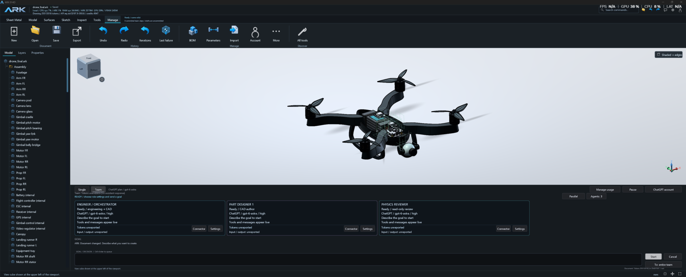

# ARK — Agent-Ready Kernel

**Open-source parametric CAD for humans and AI agents, for Windows and Linux.**

[](https://github.com/CenturyMesh/Ark/releases)
[](https://github.com/CenturyMesh/Ark/actions/workflows/build.yml)
[](LICENSE)
[](#windows-studio-and-exact-cad)
[](#linux-native-headless-runtime)
[](docs/CONNECTING.md)
[](https://github.com/sponsors/CenturyMesh)

Powered by C++ and Open CASCADE. Windows includes the graphical Studio; Linux
currently provides the headless CLI, MCP server and native geometry worker.

**Download ready-to-run preview packages - 032D / 0.9.33:**

[**Windows x64 - Studio + CLI/MCP (ZIP)**](https://github.com/CenturyMesh/Ark/releases/download/v0.9.33/ark-windows-x64-0.9.33.zip) | [**Linux x64 - headless CLI/MCP (tar.gz)**](https://github.com/CenturyMesh/Ark/releases/download/v0.9.33/ark-linux-x64-headless-0.9.33.tar.gz)

Extract the Windows ZIP and run `ARK.cmd`. For Linux, extract the archive and run
`bin/ark-mcp`; this package has no graphical Studio. These are prerelease binaries
for manual evaluation. [Release notes, checksums and OCCT source](https://github.com/CenturyMesh/Ark/releases/tag/v0.9.33).
No compilation is required to use these downloads.

The published iteration, [032D / 0.9.33](docs/iterations/032D.md), adds shared
geometry storage, reusable agent previews, compact inspection responses,
motion for patterned rigid followers and authored colors in agent snapshots.
The iteration notes record the verified scope and remaining performance limits.

Source development in [034D / 0.9.35](docs/iterations/034D.md) adds shared project
context graphs, local Graphify code lookup and an optional Obsidian vault.
[Usage and measured limits](docs/CONTEXT_GRAPHS_034D.md) distinguish local checks
from published packages and unmeasured live-provider savings.

The chat opens on first launch and remembers your visibility choice. Windows
Assistant and Team cards also offer [Grok Build through its official CLI account](docs/GROK_BUILD_CONNECT.md).

Optional installer builds and explicit personal packages are documented in
[distribution instructions](DISTRIBUTION.md). Existing published binaries keep
their own iteration identity and checksums.

ARK is a native C++ design workspace for creating editable parts, assemblies and
mechanisms. Work directly in Studio, ask an assistant to build alongside you, or
connect an external agent through MCP. Human and agent edits use the same modeling
commands, document history and revision checks.



[Get started](#get-started) · [Handbook](docs/HANDBOOK.md) ·
[Documentation](docs/README.md) · [Roadmap](docs/ROADMAP.md) ·
[Contributing](CONTRIBUTING.md) | [Sponsor](https://github.com/sponsors/CenturyMesh)

New to ARK? Try the [first-part walkthrough](docs/FIRST_TRY.md) and share a
[structured experience report](https://github.com/CenturyMesh/Ark/issues/new?template=first_experience.yml).

[**Watch the 50-second guided demo (016F)**](https://github.com/CenturyMesh/Ark/releases/download/v0.9.17/ark-guided-demo-016F.mp4)
— an edited sequence of native captures showing a parameter edit and its BOM,
with the [source and measured evidence](docs/launch/demo.md).

## What you can build

| Workspace | Available today |
|---|---|
| Parametric design | Named sketches, dimensions and expressions, constraints, construction planes and a persistent feature history |
| Exact solids and surfaces | OCCT primitives, extrudes, revolves, lofts, sweeps, supported Booleans, fillets, chamfers, patterns and surface operations |
| Assemblies and motion | Shared part definitions, instances, groups, semantic-reference mates, joint limits and supported kinematic previews |
| Sheet metal and frames | Authored panels, flanges and openings; formed/flat views; supported tube members, joints and cutlists |
| Materials and engineering | Appearance, density, rigid-body mass/centre of mass/inertia and analytical calculations with explicit assumptions |
| Parts and BOM | Local STEP component library, provenance, part metadata, occurrence quantities, missing-field review and versioned JSON export |
| Agent workflows | In-app Single and Team assistants, Focused and optional Parallel execution, read-only inspection, atomic edits and local MCP |
| Exchange | Exact part-level STEP/IGES, mesh STL/OBJ/FBX and the editable `.ark` document |

ARK is an engineering prototype with useful, tested domains. Supported geometry
can reject invalid or ambiguous inputs explicitly. Manufacturing qualification,
general FEA, arbitrary imported-sheet unfolding, associative technical drawings
and external industrial adapters remain roadmap work. See each
[module contract](docs/README.md) for its acceptance boundaries.

## Get started

### Windows Studio and exact CAD

Use Windows x64, Visual Studio 2022 Build Tools with the C++ toolchain and Windows
SDK, and CMake 3.21 or newer. Studio requires an OpenGL 3.3-capable desktop.
Run these commands from the repository root:

```powershell
.\scripts\build.ps1 -Test
.\start-studio.ps1
```

The first build downloads the pinned OCCT 8.0.1 source archive, verifies its hash,
builds the SDK and caches it under `out/deps/occt`. Allow time and disk space for
that dependency build. Subsequent builds reuse it. The native executables are in
`out/native-release/Release`.

Open an example to explore an existing editable design:

```powershell
.\start-studio.ps1 -Document .\examples\drone-hull.ark
```

Use **All tools** or **Commands** (`Ctrl+K`) to find an operation. `F` frames the
model; `Ctrl+S` saves; `Ctrl+Z` and `Ctrl+Y` undo and redo. The
[handbook](docs/HANDBOOK.md) walks through editing, assemblies, agents and export.
For SDK paths, custom builds and live Studio tests, see
[native build instructions](docs/NATIVE_BUILD.md).

### Portable core

The headless core has a separate configuration for portability checks:

```sh
cmake -S . -B out/core -DARK_WITH_OCCT=OFF -DCMAKE_BUILD_TYPE=Release
cmake --build out/core --config Release --parallel 2
ctest --test-dir out/core -C Release --output-on-failure
```

This configuration provides the non-OCCT core and headless tools. Studio, the live
Windows document bridge and built-in network/authentication transports are Windows
implementations. A portable-core result does not establish Linux native OCCT or
Linux desktop support. Those are tracked separately under
[G.04](docs/ROADMAP.md#g--advanced-platform).

### Linux native headless runtime

Linux CLI, standalone MCP and the OCCT 8.0.1 worker are locally verified in
iteration `016F`: 65/65 native tests and 42/42 core-only tests passed on Ubuntu
24.04. A relocated package passed exact-solid, STEP readback and document
save/load checks in a clean Ubuntu container without the build SDK.

```sh
sudo apt-get install -y build-essential cmake ninja-build curl ca-certificates unzip patchelf
bash scripts/build.sh --test --jobs 4
bash scripts/package-linux.sh
```

The archive contains `bin/ark-mcp`, `bin/ark-cli`, the isolated native worker,
replaceable OCCT shared libraries and dependency notices. This is a headless
distribution; Linux Studio, the live Studio bridge, network/authentication
transports and Linux OTA remain outside its verified scope. See
[Linux build and runtime requirements](docs/NATIVE_BUILD.md#linux-cli-mcp-and-native-worker--g04).

## Design with an agent

The in-app **Assistant** supports configured provider connectors, including an
eligible ChatGPT account, API providers and a local Ollama route. Choose your
connector and actual model explicitly. Account access, inference charges and local
hardware depend on that route; a model listing alone is not a successful CAD task.
CAD editing and local MCP require no model credentials. Start with
[connecting agents and accounts](docs/CONNECTING.md), then
[assistant setup](docs/ASSISTANT.md) and [connector options](docs/AI_CONNECTORS.md).

**Assistant → Team** defaults to **Focused**: an engineer authors the design and
delegates concrete work to a designer or reviewer, one conversation at a time.
**Parallel** is optional. Both retain serialized, revision-checked document writes.
[Team controls](docs/MULTI_AGENT_STUDIO.md) explain roles and settings.

For an external MCP client, a standalone server can be configured as follows:

```json
{
  "mcpServers": {
    "ark": {
      "command": "C:/path/to/ARK-Point/out/native-release/Release/ark-mcp.exe",
      "args": []
    }
  }
}
```

A standalone process owns its own document. To edit the document visible in
Studio, copy that Studio process's live endpoint and add `--connect` with the
endpoint as its argument. Use Studio's exported configuration where available;
the endpoint changes after restart. [Live connection guide](docs/CODEX_CONNECT.md).

Start with `agent_onboard` and `doc_info`. Discover tools through MCP rather than
assuming a fixed tool count. Inspect semantic references before attaching geometry
or mating parts, and submit edits through `doc_apply` with the observed
`expected_revision`. [Agent protocol](docs/AGENTS.md).

## Explore the examples

| Example | What it demonstrates |
|---|---|
| [Drone hull](examples/drone-hull.ark) | Parametric hull, electronics openings, shared motor arms and a lofted/thickened canopy |
| [Six-axis robot](examples/six-axis-robot.ark) | Reused part definitions and a parameter-driven articulated hierarchy |
| [Sheet flange tree](examples/sheet-flange-tree.ark) | Base panel, signed flanges, openings and formed/flat display poses |
| [KITE 17](examples/kite-17-showcase.ark) | A folded-sheet coupe with a tubular frame; [showcase guide](docs/KITE_SHOWCASE.md) |
| [KITE suspension](examples/kite-17-suspension.ark) | Checked kinematic corner previews; [scope and limits](docs/SUSPENSION.md) |
| [Integrated vehicle](examples/vehicle-engineering.ark) | Frame, mechanical electronics layout and cable-routing workflows |

Examples are modeling demonstrations. Their presence does not qualify a vehicle,
robot, flight design or manufacturing process. Included `.arkops` files replay
public tool calls; the `.ark` file preserves the editable design.

## Geometry and evidence

Exact native B-reps and explicit inputs determine supported production geometry.
Viewport meshes and images communicate a design; they do not replace its exact
geometry. Explicit mesh operations produce mesh results with their own limitations.
Sheet lengths depend on the declared K factor, not an inferred material calibration.

Tests distinguish native modeling, portable core, persistence, MCP, updates and
desktop interaction. A headless pass does not prove UI rendering or manufacturing
readiness. [Validation records](docs/VALIDATION.md),
[iteration evidence](docs/README.md#release-history-and-evidence) and
[the roadmap](docs/ROADMAP.md) state what was observed and what remains open.

## Project and contributions

The application version and public iteration code come from [release.json](release.json).
Codes such as `015B` combine a globally increasing sequence with a roadmap phase;
the letter is not a month. Runtime versions and document-format versions are
separate. See [development rules](AGENTS.md).

Contributions use topic branches and pull requests against `main`. Start with a
reproducible issue or a scoped proposal, add appropriate verification, and preserve
user documents and dependency notices. The
[contribution guide](CONTRIBUTING.md) covers setup, branches, tests and review;
[security policy](SECURITY.md) covers vulnerability reporting.

Support ARK development through [GitHub Sponsors](https://github.com/sponsors/CenturyMesh).
See [sponsorship details](docs/SPONSORSHIP.md); sponsorship does not change the
open-source license or create a paid support commitment.

ARK source is licensed under [Apache-2.0](LICENSE); see [NOTICE](NOTICE).
Dependencies retain their individual terms; see
[third-party notices](docs/THIRD_PARTY_NOTICES.md).
See [licensing and distribution guidance](docs/COMMERCIAL_STRATEGY.md).
Windows update staging and rollback exist; a trusted online release channel
still requires deployment and an end-to-end test. [Update contract](docs/UPDATES.md).

Created by MeshSphere, led by Bruno Santos.
