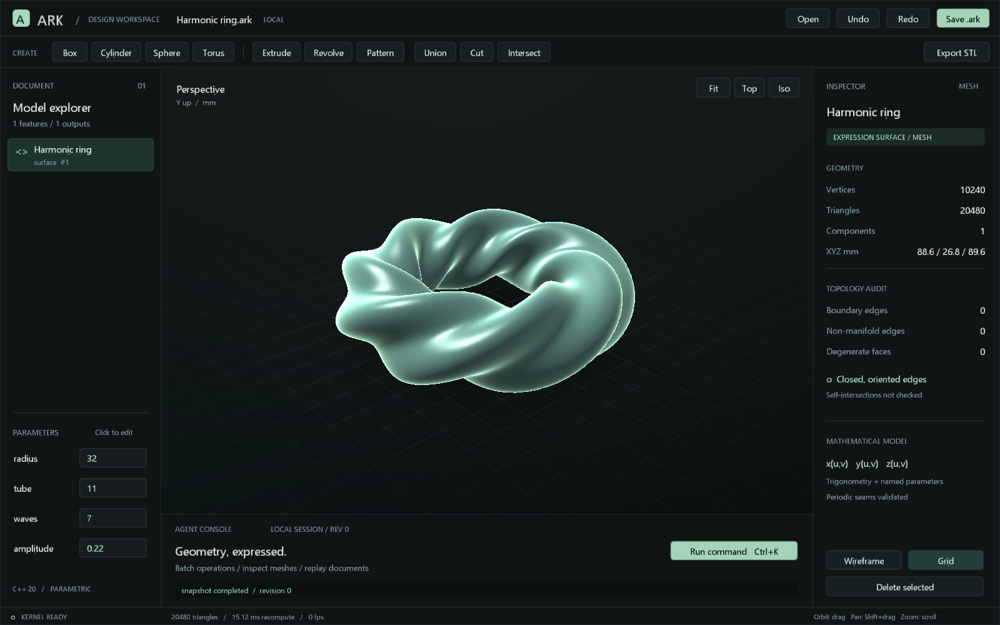

# ARK

A C++ geometry workspace designed to be operated by people and agents.



ARK combines a native Windows/OpenGL editor, a headless geometry library and a local MCP server. All new editor commands and MCP tools use the same `AgentSession` implementation. It is an **early engineering prototype**, with an existing custom kernel extended and corrected here, not yet an industrial CAD replacement.

## Run

Windows requirements: CMake 3.20+, Ninja and a C++20 compiler on PATH. The included PowerShell build uses MinGW-w64; MSVC can build through CMake from a Developer terminal.

```powershell
.\scripts\build.ps1 -Test
.\start-studio.ps1
# Open a saved document:
.\start-studio.ps1 -Document .\examples\harmonic-ring.ark
```

The kernel and MCP also build on Linux:

```sh
cmake -S . -B out/build -DCMAKE_BUILD_TYPE=Release
cmake --build out/build --parallel 4
ctest --test-dir out/build --output-on-failure
```

Targets: `ark` static library, `ark-mcp`, `ark-cli` (legacy demonstration), `ark-tests`, `ark-agent-tests`, and `ark-studio` on Windows. No JavaScript runtime, web server, cloud account or model subscription is required by ARK itself. MinGW executables link their runtime statically.

## Work in Studio

- Orbit by dragging, pan with Shift+drag, zoom with the wheel; `F` frames the model.
- Click an output in the tree or viewport to inspect it. Mouse-wheel over the tree scrolls history.
- Click a named parameter to edit its expression. The example's `radius`, `tube`, `waves` and `amplitude` change the harmonic surface.
- Use the toolbar for primitives, extrude, revolve, pattern and mesh booleans. Boolean buttons operate on the last two terminal outputs.
- `Ctrl+K` opens the JSON command editor; `Ctrl+Enter` submits a multiline command.
- `Ctrl+S` saves, `Ctrl+O` opens, `Ctrl+Z` undoes, `Ctrl+Y` redoes, `W` toggles wireframe, Delete removes the selected output.

## Agents

Start `out/build/ark-mcp.exe` as a local MCP stdio server from your MCP client. The interface is model independent: an Astra or other agent host can drive it **if that host can invoke MCP tools**. ARK does not embed a language model or provide a natural-language chat service.

```json
{
  "mcpServers": {
    "ark": {
      "command": "C:/path/to/Ark/out/build/ark-mcp.exe",
      "args": []
    }
  }
}
```

This is a generic MCP configuration example; the host's configuration format may differ. See [agent protocol](docs/AGENTS.md) for the tool contract and examples. Studio and a separately launched MCP process each own an independent session. Use `.ark` files to hand work between them; live cross-process synchronization is not implemented.

## What is implemented

| Layer | Current capability |
| --- | --- |
| Math | f64 vectors, matrices, quaternions, arithmetic/trigonometric expressions, named parameter dependency resolution |
| Geometry | Analytic primitive faces, NURBS curve/surface evaluation, extrude/revolve, mesh BSP boolean operations, transforms and linear patterns |
| Complex surfaces | `x(u,v)`, `y(u,v)`, `z(u,v)` with named expressions, indexed tessellation and validated periodic seams |
| Mesh reasoning | Cached geometry and topology reports, bounds, area, connected components, oriented-edge checks, BVH ray intersection and explicit buffer retrieval |
| Agent transactions | Batches of up to 128 commands, one geometry recompute, rollback on failure, expected revision, stable feature IDs, 32 undo steps |
| Files | `.ark` versioned JSON document; `.arkjson` compatibility; `.arkops` line-by-line command replay; STL/OBJ export; PNG snapshots |
| Studio | Native GPU viewport, selection, model tree, expression editing, mesh inspector, command console, open/save and undo/redo |

See [file formats](docs/FORMATS.md), [assessment and roadmap](docs/ASSESSMENT.md), and [validation](docs/VALIDATION.md).

## Boundaries

Boolean outputs and expression surfaces are meshes. Closed oriented edges do not establish freedom from self-intersection or a manufacturing-valid solid. The existing B-rep does not yet implement a complete shared edge/vertex topology, robust exact boolean operations or persistent face naming. Primitive tessellation does not consistently honor all `TessOptions`. STL/OBJ import, STEP exchange, fillets, robust remeshing, assemblies and a production constraint solver remain future work.

Trace and Stage are possible future adapters. This project currently has no runtime dependency on either.
