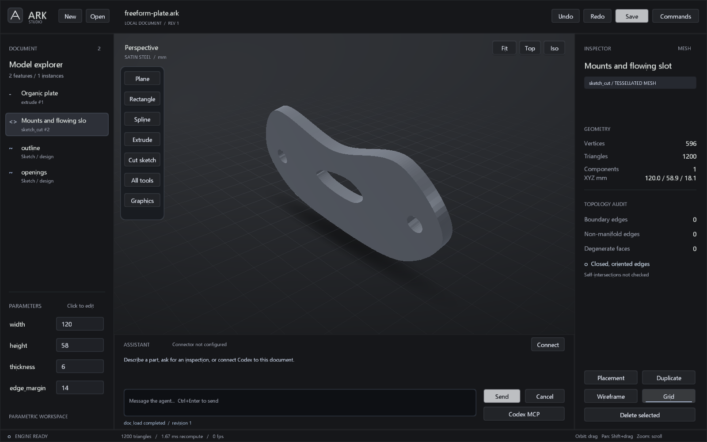

# ARK — Agent-Ready Kernel

**Parametric CAD for people and agents.**

A C++ geometry workspace with native modeling tools and an agent API.



ARK combines a native Windows/OpenGL editor, a headless geometry library and a local MCP server. All new editor commands and MCP tools use the same `AgentSession` implementation. It is an **early engineering prototype**, with an existing custom kernel extended and corrected here, not yet an industrial CAD replacement.

## Run

Windows requirements: CMake 3.20+, Ninja and a C++20 compiler on PATH. The included PowerShell build uses MinGW-w64; MSVC can build through CMake from a Developer terminal.

```powershell
.\scripts\build.ps1 -Test
.\start-studio.ps1
# Open a saved document:
.\start-studio.ps1 -Document .\examples\harmonic-ring.ark
```

The kernel and MCP have portable CMake targets for Linux; CI execution is currently blocked by the GitHub account billing limit:

```sh
cmake -S . -B out/sketch -DCMAKE_BUILD_TYPE=Release
cmake --build out/sketch --parallel 4
ctest --test-dir out/sketch --output-on-failure
```

Targets: `ark` static library, `ark-mcp`, `ark-cli` (legacy demonstration), `ark-tests`, `ark-agent-tests`, and `ark-studio` on Windows. No JavaScript runtime, web server, cloud account or model subscription is required by ARK itself. MinGW executables link their runtime statically.

## Work in Studio

- Orbit by dragging, pan with Shift+drag, zoom with the wheel; `F` frames the model.
- Click an output in the tree or viewport to inspect it. Mouse-wheel over the tree scrolls history.
- Click a named parameter to edit its expression. The example's `radius`, `tube`, `waves` and `amplitude` change the harmonic surface.
- Use the floating dock or **Commands** menu for sketches, primitives, extrude/revolve, patterns, tubes and assemblies. Body Boolean actions use the last two terminal outputs.
- `Ctrl+K` opens Commands; its **Raw agent command** action opens the JSON editor. `Ctrl+Enter` sends assistant input or submits a multiline raw command.
- `Ctrl+N` starts a new document, `Ctrl+S` saves, `Ctrl+O` opens, `Ctrl+Z` undoes, `Ctrl+Y` redoes, `W` toggles wireframe, Delete removes the selected output.
- **Graphics** changes viewport preferences; **Connect** configures the assistant API and **Codex MCP** shows the live document endpoint. [Studio guide](docs/STUDIO.md).

## Agents

Start `out/sketch/ark-mcp.exe` as a local MCP stdio server from your MCP client. The interface is model independent: an Astra or other agent host can drive it **if that host can invoke MCP tools**. ARK does not embed a language model or provide a natural-language chat service.

```json
{
  "mcpServers": {
    "ark": {
      "command": "C:/path/to/Ark/out/sketch/ark-mcp.exe",
      "args": []
    }
  }
}
```

This is a standalone MCP configuration. Call `agent_onboard` first for the current document, supported operations and examples. To operate the open Studio document, use `ark-mcp --connect <endpoint>` as described in [Codex and live Studio](docs/CODEX_CONNECT.md). Standalone sessions remain independent. See [agent protocol](docs/AGENTS.md).

## Parametric sketches and agent onboarding (0.7)

Named construction planes, expression-driven sketch coordinates/dimensions and
compact interpolating splines now drive extrusion and sketch cuts. Change a
parameter to update the outline and preserve hole edge distances. Agents can
replace a single curve by name, inspect constraint status and request curve
samples only when needed. [Contracts and examples](docs/PARAMETRIC_SKETCH.md).

`agent_onboard` is the entry point for an agent: current document/revision,
capabilities, limits, modeling loop and runnable topic-specific examples. Native
Studio, the in-app assistant and connected MCP clients use the same command
implementation. [Responses connector](docs/ASSISTANT.md) and
[Codex live connection](docs/CODEX_CONNECT.md).

## STEP source with its original holes (0.6)

Use **Import STEP** to load a supported planar tube, preserving its actual circular/polygonal openings and cutouts. The source can be viewed formed or straight, animated through its measured finite-radius hinges, and exported as a straight STEP with the original geometry. Clicking an opening focuses the real cut. [Projection method, evidence and supported domain](docs/SOURCE_STEP.md).

The imported source stays read-only; it is not replaced with an approximate empty tube. Geometric source verification is separate from physical manufacturing qualification.

## Interactive laser tube (0.5)

```powershell
.\start-studio.ps1 -Document examples/laser-tube.ark
```

Choose **Laser tube**, define stock and **Add bend** points, then use **Play**, **Straight**, **Folded** or the slider to inspect the motion. **Save** keeps the editable design; **Export straight STEP** always writes the straight notched tube, regardless of the animation pose. [Controls, geometry contract and backend setup](docs/BEND_WORKSPACE.md).

## Neutral desktop UI and notch STEP preview (0.4)

Studio now uses a neutral graphite palette, satin steel shading, a geometric ARK logo and an icon ribbon. Primitive dimensions and placements use native property dialogs; expressions and agent commands have dedicated editors. The kernel stays independent of these presentation controls. The interface remains native Win32/OpenGL. A future WPF presentation host can interoperate with native C++, as described in [Microsoft documentation](https://learn.microsoft.com/en-us/dotnet/desktop/wpf/advanced/wpf-and-win32-interoperation); this release does not migrate the application to WPF.

The new C++ `notch_plan` tool can produce a straight rectangular tube cut plan with a retained hinge wall. An optional OCCT bridge exports and checks the actual STEP solid. See [workflow, example STEP and mathematical evidence](docs/NOTCH_WORKFLOW.md). This 0.4 workflow is an ideal geometric preview. The later 0.6 source workflow above adds bounded source-preserving unfolding; physical qualification remains separate.

## Assemblies, tube bending and GPU compute (0.3)

```powershell
.\start-studio.ps1 -Document examples/welded-support.ark
.\start-studio.ps1 -Document examples/spatial-tube.ark
```

Assemblies have shared part definitions, nested groups, independent rigid placements and BOM quantities. Studio shares GPU mesh buffers and local BVHs between instances. Use **Assembly**, **Duplicate** and **Placement** to organize parts. Tube programs support round and rectangular hollow sections, multiple bends and plane rotations. **Tube** creates a bend; **Edit tube program** changes its section and bend sequence.

An optional CUDA backend accelerates large packed position transforms, while analytic geometry and placement calculations stay in f64. It loads the installed NVIDIA driver and NVRTC runtime dynamically; CUDA headers must be available when configuring the build and `CUDA_PATH` must locate NVRTC at runtime. No nvcc build or GPU driver change is required. CPU builds and fallback remain supported. [Scope, measurements and MeshARC assessment](docs/MECHANICAL.md).

## What is implemented

| Layer | Current capability |
| --- | --- |
| Math | f64 vectors, matrices, quaternions, arithmetic/trigonometric expressions, named parameter dependency resolution |
| Geometry | Analytic primitive faces, NURBS curve/surface evaluation, extrude/revolve, mesh boolean operations, transforms and linear patterns |
| Complex surfaces | `x(u,v)`, `y(u,v)`, `z(u,v)` with named expressions, indexed tessellation and validated periodic seams |
| Mesh reasoning | Cached geometry and topology reports, bounds, area, connected components, oriented-edge checks, BVH ray intersection and explicit buffer retrieval |
| Agent transactions | Batches of up to 128 commands, one geometry recompute, rollback on failure, expected revision, stable feature IDs, 32 undo steps |
| Assemblies | Shared part definitions, nested groups, rigid instance placement, visibility and BOM quantities |
| Tube programs | Round/rectangular hollow profiles, planar/spatial bends, geometric developed length and bend tables |
| Compute | GPU model transforms with shared display buffers; optional CUDA packed transforms and reproducible CPU/GPU benchmark |
| Files | `.ark` versioned JSON document; `.arkjson` compatibility; `.arkops` line-by-line command replay; STL/OBJ export; PNG snapshots |
| Studio | Native GPU viewport, selection, model tree, expression editing, mesh inspector, command console, open/save and undo/redo |

See [file formats](docs/FORMATS.md), [assessment and roadmap](docs/ASSESSMENT.md), and [validation](docs/VALIDATION.md).

## Boundaries

Boolean outputs and expression surfaces are meshes. Closed oriented edges do not establish freedom from self-intersection or a manufacturing-valid solid. The existing B-rep does not yet implement a complete shared edge/vertex topology, robust exact boolean operations or persistent face naming. Primitive tessellation does not consistently honor all `TessOptions`. STL/OBJ import, general B-rep STEP modeling/export, fillets, robust remeshing, assembly mate solving and a production constraint solver remain future work. The specialized tube STEP workflows above are implemented.

Trace and Stage are possible future adapters. This project currently has no runtime dependency on either.
