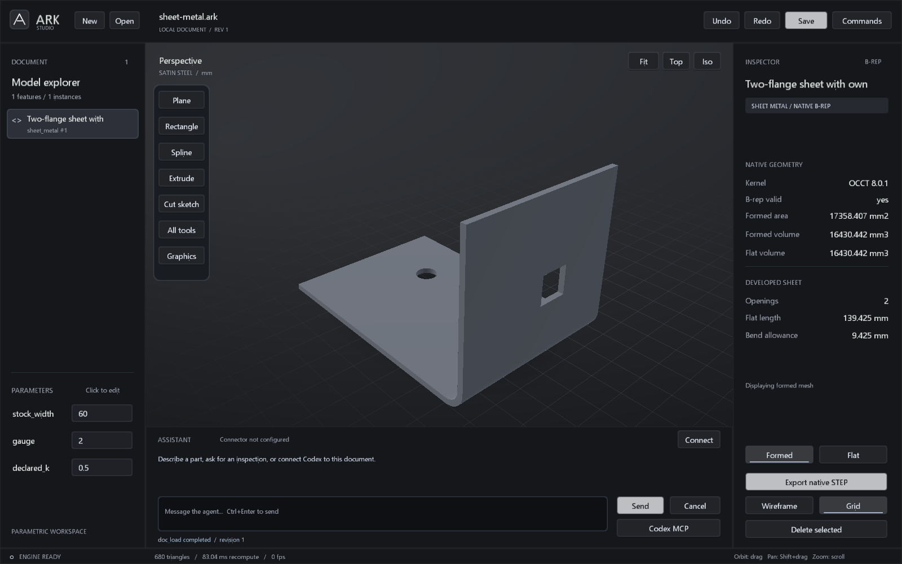

# ARK 0.8 — Agent-Ready Kernel

**Parametric CAD for people and agents.**



ARK is a C++ parametric CAD workspace with a Windows Studio editor, a headless
modeling library, and a local MCP server. Studio and MCP operate on the same
document, feature history, undo stack, and revision when connected. ARK is an
engineering prototype; its native STEP and sheet domains are deliberately
bounded.

## Build and run on Windows

Install CMake 3.21+ and Visual Studio 2022 Build Tools with the x64 C++ and
Windows SDK components. The default build uses MSVC and Open CASCADE Technology
(OCCT) 8.0.1. The first run downloads, verifies, builds, and installs the OCCT
SDK under ignored `out/deps/occt`; subsequent builds reuse it.

```powershell
.\scripts\build.ps1 -Test
.\start-studio.ps1
.\start-studio.ps1 -Document .\examples\freeform-plate.ark
# Force a tested rebuild before opening Studio:
.\start-studio.ps1 -Rebuild
```

The native executables are in `out/native-release/Release`. `start-studio.ps1` accepts
`-BuildDirectory` for another MSVC build tree and stops if its build or tests
fail. The prior `out/sketch` MinGW binaries are left in place; they are not the
0.8 native build. [SDK source, license, and paths](docs/NATIVE_BUILD.md).

The C++ core can be configured without OCCT for portability checks:

```sh
cmake -S . -B out/core -DARK_WITH_OCCT=OFF -DCMAKE_BUILD_TYPE=Release
cmake --build out/core --config Release --parallel 2
ctest --test-dir out/core -C Release --output-on-failure
```

This core configuration does not provide native STEP modeling. The native OCCT
job in CI runs on Windows; this repository does not claim a proven Linux native
OCCT build. GitHub Actions execution may remain unavailable while the account
billing restriction recorded in [validation](docs/VALIDATION.md) persists.

## Work in Studio

Use the floating dock or **Commands** (`Ctrl+K`) for sketches, primitives,
assemblies, tubes, native surfaces, and sheet metal. Orbit by dragging, pan
with Shift+drag, and zoom with the wheel. `F` frames the model. `Ctrl+N`,
`Ctrl+O`, `Ctrl+S`, `Ctrl+Z`, and `Ctrl+Y` manage the document and history.

Native surface commands create lofts from saved sketch sections, fill closed
sketches, edit a NURBS pole grid, and thicken an open native surface. The sheet
form creates a finite-radius L bend with explicit thickness, radius, angle,
and K factor. **Formed** and **Flat** select display poses without modifying
the document. Sheet STEP export asks for a pose and defaults to the flat blank.
See [Studio controls](docs/NATIVE_STUDIO.md) and [surfacing contracts](docs/SURFACING.md).

Source STEP tools preserve supported original geometry and openings. Tube
sources keep their separate straight/folded hinge preview. Sheet sources are
read-only and are verified against their original STEP and a refolded native
B-rep. Imported sheet support is limited to one uniform-thickness panel or
two rigid flanges joined by one complete straight cylindrical bend. The
importer rejects ambiguous and unsupported shapes; it does not silently
approximate them. See [source tube](docs/SOURCE_STEP.md) and
[sheet metal](docs/SHEET_METAL.md).

## Connect an agent

Start `out/native-release/Release/ark-mcp.exe` as a local MCP stdio server. Each
standalone process owns one document. To operate the open Studio document,
connect the MCP process to Studio's displayed endpoint as described in
[Codex and live Studio](docs/CODEX_CONNECT.md).

```json
{
  "mcpServers": {
    "ark": {
      "command": "C:/path/to/ARK-Point/out/native-release/Release/ark-mcp.exe",
      "args": []
    }
  }
}
```

Call `agent_onboard` first for the current revision, supported operations,
and examples. ARK exposes 30 MCP tools, including `kernel_info`,
`native_inspect`, `step_inspect`, and `import_sheet_step`. `doc_apply` batches
edits atomically and rejects stale revisions. The [agent protocol](docs/AGENTS.md)
describes the command and validation contracts. The in-app assistant uses a
separately configured Responses-compatible service; modeling, Studio, and MCP
do not require API credentials.

## Geometry boundary

The earlier custom C++ primitive, expression-surface, mesh, and assembly paths
remain available. OCCT 8.0.1 supplies exact B-reps for the new loft, filling,
NURBS, thickening, sheet, source import, and STEP operations. A viewport mesh
is a tessellated preview, not the STEP authority. Native surfaces and sheets
cannot be silently routed through the legacy approximate transform, Boolean,
or sketch-cut operations; use parameter changes, construction planes, and
assembly placement where supported.

Sheet flat length uses the caller's declared K factor. It does not infer a
material calibration or certify forming. A non-midwall K factor can produce a
modeled formed/flat volume difference, reported explicitly. Native B-rep
validity, source refold checks, and source hashes are geometric evidence, not
manufacturing qualification. General exact B-rep support for every legacy
feature, fillets, arbitrary multi-bend sheet unfolding, and a production
constraint solver are outside this release.

All current production code and test programs are C++; no Python runtime or
test gate is required. Run `scripts/build.ps1 -Test` for the native CTest set.
The independent stdio check is in CTest. The live-Studio process check is an
explicit C++ opt-in because hosted CI may not provide the OpenGL 3.3 context
needed by Studio; a headless CTest result does not establish UI rendering.
See
[validation](docs/VALIDATION.md), [file formats](docs/FORMATS.md), and the
[engineering assessment](docs/ASSESSMENT.md).
