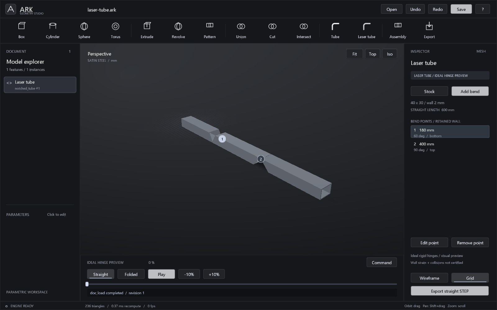
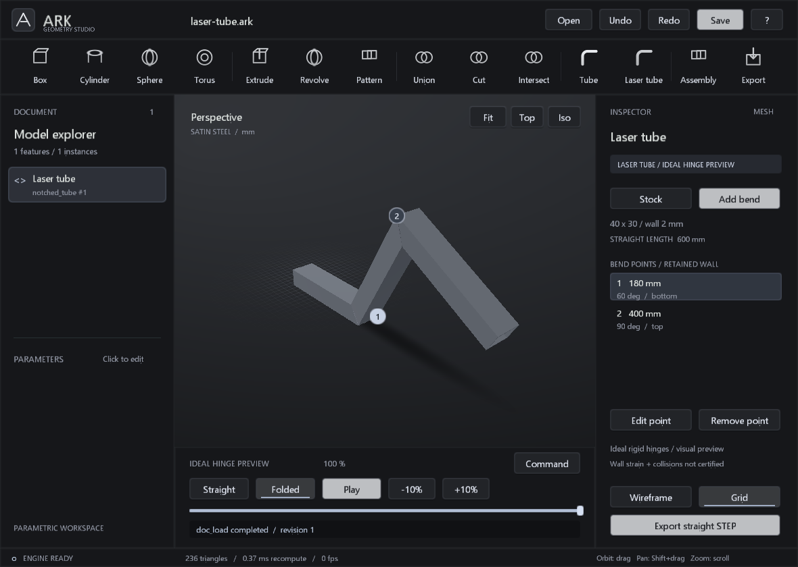

# Laser tube workspace



The laser-tube design, its bend points, the animated preview and straight STEP export are now connected in Studio. Open `examples/laser-tube.ark` or choose **Laser tube** in the ribbon to start with straight rectangular hollow stock.

## Controls

1. **Stock** edits width, height, wall thickness, straight length and the assumed hinge offset within the retained wall.
2. **Add bend** creates a point by its station along the straight stock, target angle and retained wall (`bottom`, `top`, `left`, `right`). Dimensions and angles accept expressions.
3. Select a numbered viewport marker or a point in the list; **Edit point** and **Remove point** operate on that point. Removing the last point leaves ordinary straight stock.
4. **Play/Pause**, the slider and ±10% controls preview bending. **Straight** and **Folded** select the endpoints. Bends progress sequentially in station order.
5. **Save** / Ctrl+S stores the editable design in `.ark`. Reopening preserves stock expressions and every bend point.
6. **Export straight STEP** writes the straight stock with its notches, plus `.arkcut` intent and `.validation.json`. The result always uses the straight pose, including when the viewport is paused halfway or fully folded.



## Geometry and animation

The native kernel clips planar stock boundaries against the same cutter planes used by `notch_plan`. It builds a closed straight mesh and closed display segments separated at the hinge stations. Shared edge subdivisions are resolved in double precision before conversion to display floats. Straight and segment topology are checked, and straight mesh volume is checked against the analytical cut volume. The legacy mesh CSG healing tolerances are not used by this preview builder.

Segment meshes, BVHs and GPU buffers are cached on document changes. Animation changes model matrices only. A point on the moving segment is transformed about its hinge axis, with preceding transforms composed in station order. At zero progress all transforms are identity. At full progress the two cut faces coincide under the ideal rigid-hinge equations; tests verify this for all four wall orientations and multiple hinges.

For display, the retained wall is split between rigid segments. This is a kinematic preview: it does not solve the continuous deformation, strain, thickness changes or collision behavior of the ligament. In particular, a visually closed joint is not proof of physical forming suitability. The exported straight solid keeps the retained wall continuous and is separately checked using OCCT.

Animation state never changes feature parameters or the document revision, and is not saved as fabricated geometry. An assembly instance applies its placement outside the bend transforms. STEP export currently exports the selected part definition in its straight local coordinates, not a whole assembly.

## Agents and persistence

The new feature type is `notched_tube`:

```json
{
  "op":"feature.add",
  "type":"notched_tube",
  "name":"Laser tube",
  "p":{"width_mm":"40","height_mm":"30","wall_mm":"2","length_mm":"600","hinge_offset_mm":"1"},
  "notches":[
    {"station":"180","angle":"60","face":"bottom"},
    {"station":"400","angle":"90","face":"top"}
  ]
}
```

Use the existing `doc_apply` batch for creation/editing. `feature.edit` replaces the `notches` array when it is supplied. `notch_inspect{id}` returns the evaluated request and plan; optional `progress` in `[0,1]` returns segment matrices and display bounds without mutating the document. `export_step{id,path}` invokes the exact STEP bridge in the straight pose. There are now 20 MCP tools.

Documents containing this feature use `.ark` version 3. Readers remain compatible with versions 1 and 2. Version 0.4 and older applications reject the new document version rather than discarding bend points.

## Optional STEP backend

Viewing, modeling and animation are native C++ and do not need OCCT/Python. Exact STEP export uses the existing `scripts/export_notch_step.py` adapter and the pinned optional requirements in `scripts/requirements-occt.txt`.

The Windows application searches for the backend in this order:

- `ARK_OCCT_PYTHON`, pointing to a Python executable with those requirements.
- The ignored project-local `.ark-local.json`, for example `{"occt_python":"C:/PythonWithOCCT/python.exe"}`.
- `.venv-occt/Scripts/python.exe` in the project.
- `python.exe` on PATH.

The local installation has been configured using the existing OCCT-capable environment. No Python dependency is copied into the repository. Missing backends return an actionable error rather than substituting an STL export. The script must remain available alongside the source tree; standalone installer packaging is future work.

The worker starts without a console, receives a temporary plan file, and runs inside a Windows Job Object with a 30-second limit. It captures output, returns the validation receipt, and cleans up its own temporary files. It accepts paths with spaces and Unicode. The integrated process bridge is currently Windows-specific; the standalone exporter script remains available elsewhere.

## Verification

- Six local CTest suites passed, including 60 bend-workspace checks.
- Tests cover zero points, all retained wall sides, closed segment/straight meshes, analytical volume, identity pose, sequential activation and full cut-face closure.
- Native workspace fixtures exercise stock and point dialogs, creation/edit/removal, undo, save/reload, play/pause, percentage controls and cached geometry reuse.
- Native export at 100% folded produced a valid straight STEP with one solid and zero Boolean symmetric-difference volume on readback.
- Worker integration checks folded inspection leaves the document unchanged, zero-point stock export, Unicode paths and missing-backend failure without document changes.
- Existing UI/dialog and assembly regression fixtures still pass. These use native in-app action fixtures, not an exhaustive external mouse/keyboard test.

The workflow operates on an explicit laser-tube design. Automatic reconstruction and refolding against the supplied `SKT01.DCB109.STEP` remain separate, uncompleted work described in [NOTCH_WORKFLOW.md](NOTCH_WORKFLOW.md).
