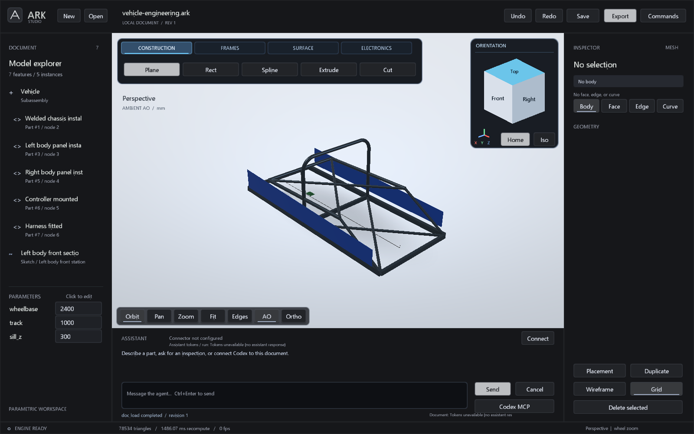

# Construction Frames, PCB and cabling

These C++ modules share the parametric document, atomic agent transactions and
OCCT worker. Their authored programs save in `.ark` version 16. The MCP surface
has 43 tools including the sheet and usage extensions. Start with `agent_onboard` topics `frames`, `electronics` or
`routing`; the examples include the current revision.

## Construction Frames

`construction_frame` stores named profiles, nodes, members and joints in
`native`. Profiles use `round` (`od`, `wall`) or `rect` (`width`, `height`,
`wall`) sections. They can supply `density_g_cm3` or reference a document
`material`. Nodes have a unique `name` and expression-driven `xyz` coordinates.

A straight member references `start` and `end` nodes. A bent member supplies
`start`, `direction`, optional section `normal`, and a sequence of straight
lengths and circular bends (`radius`, `angle`, `roll`). Optional `end` verifies
the resulting endpoint. Both section types produce exact hollow B-reps.
The original `cope` joint cuts a round member against a straight round host.
Version 25 adds bounded straight-member `trim_extend`, explicit `trim_plane`
and separate exact triangular weld beads. See
[frame and sheet operations](FRAME_SHEET_OPERATIONS.md) for commands, evidence
and unsupported domains.

`frame_inspect{id}` returns member frames, centerline stock lengths, exact
volumes, joints and explicit bead reports. Aggregate mass/COM requires density
for every member profile and bead. Density edits refresh those results.
Untrimmed overlaps count separately. Declared bead geometry does not establish
fusion, springback, stock tolerances or structural/crash analysis.

`reference_inspect` exposes `member.<name>.<producer-reference>` names. A
`plane.set` support can name its producer feature or use its ID; the saved
reference stores the ID. Ordinary loft and thicken features then build body
panels from those datums and shared parameters.

## PCB

`pcb.native` contains an outline, substrate thickness, copper layers, named
net pads, routed traces, vias, mounting holes, components and design rules.
The geometry includes an exact substrate and separate copper/package solids.
`p.thickness`, `p.clearance`, `p.edge_clearance`, `p.min_trace_width`,
`p.min_drill` and `p.min_annular_ring` allow compact expression edits.

The bounded DRC checks the polygon outline, board edges, copper clearances
between nets, holes, trace width, drills and via annular rings. Disconnected
same-net islands are retained for iterative design and reported explicitly.
`electronics_inspect{id}` returns DRC scope, connectivity and component BOM.
This is a mechanical PCB/layout module; it has no schematic editor,
electrical simulation, signal-integrity analysis or general PCB autorouter.

`pcb_export{id,path_prefix}` writes copper/outline Gerber, PTH/NPTH Excellon and
a JSON netlist. These remain fabrication previews requiring independent CAM
review. A uniform feature density cannot represent the board's different
materials; PCB mass is explicitly unavailable without a physical component BOM.

## Cabling and routing

`cable_route` accepts start/end points (optionally named), waypoints, cable
radius, minimum bend radius and declared axis-aligned box obstacles. Numeric
values can be parameter expressions. `auto_route:true` enables a bounded,
deterministic detour search. The exact worker rounds the bends, sweeps the
cable and independently checks distance against the declared obstacles.

`electronics_inspect` returns routed points, endpoint names, length and exact
obstacle clearance. It does not infer obstacles from every other scene body,
or model moving harnesses, clips, connector pinouts or thermal constraints.
Limits include 32 waypoints and 64 obstacles. Unsupported routes fail atomically.

## Integrated example

[vehicle-engineering.ark](../examples/vehicle-engineering.ark) combines an
18-member chassis, bent round hoop, rectangular rails, one cope joint, two
lofted/thickened panels, controller PCB and routed harness. It is a modeling
demonstration, not a qualified vehicle design. Engineering coordinates are
Z-up; the `Vehicle` assembly maps them to the Studio's Y-up display.

The two replay batches are
[frame-chassis-bodywork.arkops](../examples/frame-chassis-bodywork.arkops) and
[frame-chassis-electronics-addon.arkops](../examples/frame-chassis-electronics-addon.arkops).
Apply them to an empty MCP document at revisions 0 and 1 respectively.
Use `doc_save` afterwards. In an existing Studio session, inspect the revision
and adapt `expected_revision`; do not assume an empty document.

