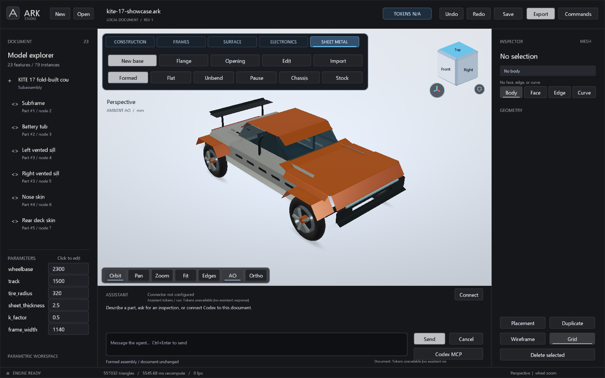
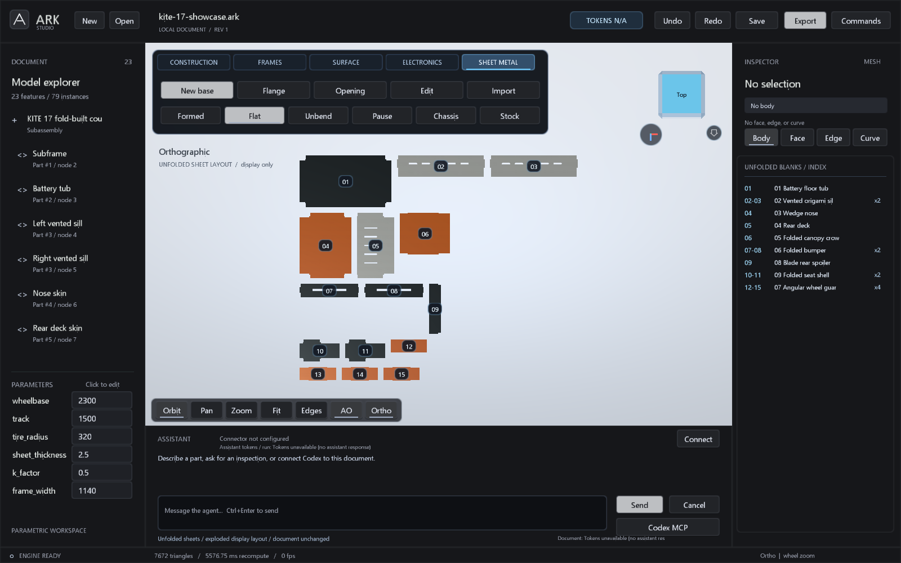
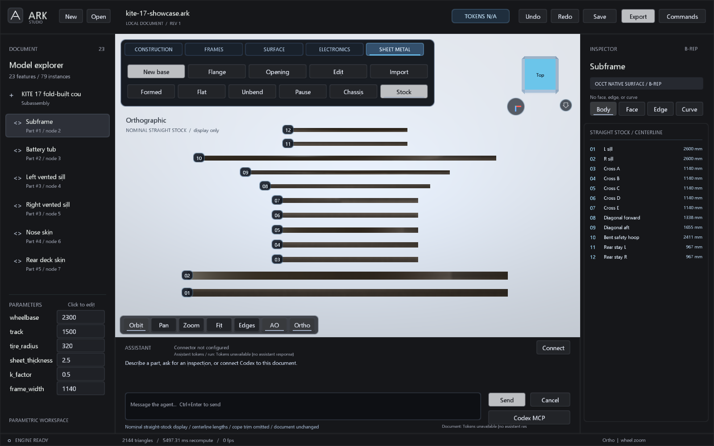

# KITE 17: fold-built electric coupe

Open [kite-17-showcase.ark](../examples/kite-17-showcase.ark) in the updated
Studio. The concept combines a round/rectangular tubular subframe with an
angular sheet body, vented sills, folded wheel guards, a canopy crown, battery
tub, folded seat shells and a rear spoiler. The wheels, lights and transparent
glazing make the assembly readable as a car rather than a bare structure.

The document contains 23 feature definitions, 9 sheet definitions and 79 placed
parts. Repeated wheel guards, bumpers, seats and sills share definitions.
The 9 sheet definitions contain 24 authored bends; every part has exact formed
and developed B-reps. K is explicitly 0.5 for this geometric demonstration.



## View the showcase

Choose **SHEET METAL** in the ribbon:

- **Formed** restores the assembled car.
- **Unbend** plays the sequential, display-only unfolding preview; **Pause**
  stops the animation.
- **Flat** arranges the unfolded panels apart so the blanks can be inspected.
- **Chassis** includes or hides the non-sheet assembly during that view.
- **Stock** shows the subframe's nominal straight tube blanks. Their centerline
  lengths are retained; cope cuts and forming effects are not represented.

The views do not edit the document revision or change the geometry used by
STEP/DXF export. The orientation cube now floats in the viewport without its
old opaque card. Chamfered edges, face hover and triangle-based picking keep
it readable and aligned with its clickable geometry.





Reproducible Studio captures use:

```powershell
.\out\native-release\Release\ark-studio.exe --load examples/kite-17-showcase.ark --showcase-view formed --shot out/kite-formed.png
.\out\native-release\Release\ark-studio.exe --load examples/kite-17-showcase.ark --showcase-view flat --shot out/kite-flat.png
.\out\native-release\Release\ark-studio.exe --load examples/kite-17-showcase.ark --showcase-view stock --shot out/kite-stock.png
.\out\native-release\Release\ark-studio.exe --load examples/kite-17-showcase.ark --showcase-progress 0.5 --shot out/kite-half.png
```

The [two-batch replay](../examples/kite-17-showcase.arkops) starts in an empty MCP
document at revision 0. Existing sessions must inspect their revision first.
The demonstration is authored CAD, not a crash-tested vehicle or fabrication
release. The animation does not check press-tool access or the whole bend path.

## Drawing token counter

The top-bar token badge now belongs to the drawing. Its receipt ledger survives
save/load; geometry undo/redo cannot remove already reported consumption.
Click the badge for reported input/output totals and provenance.

Studio records provider usage from its internal assistant. An external MCP
client can submit its actual provider receipt with `usage_record`, using a
stable receipt ID so retries cannot duplicate the count. `usage_info` reads
the ledger. Calls omitted by the provider remain missing, and external coverage
is explicitly unknown. ARK cannot infer the tokens consumed by this external
conversation, so this showcase correctly starts at **TOKENS N/A**, not zero.

The ledger has a separate metadata serial; recording usage does not recompute
geometry or change its revision. Metadata changes still make the document
unsaved in Studio. Receipts are capped at 256 and overflow rejects rather than
discarding historical totals. Usage metadata and the new slot/window opening
kinds use `.ark` version 17.
