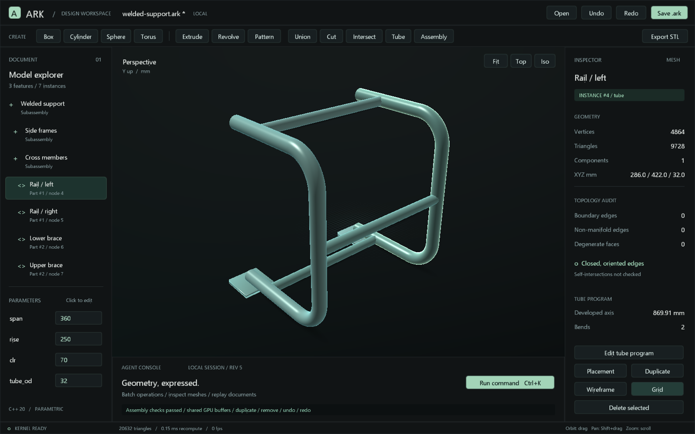

# ARK assemblies, tube programs and GPU computation



## Assemblies

Part geometry remains in the feature history. Assembly nodes reference those definitions, so changing one part updates all of its instances. A node with `feature:0` is a group; otherwise it references a feature ID. Groups can be nested up to 64 levels. `parent:0` identifies a root node. Local placement parameters `tx`, `ty`, `tz`, `rx`, `ry`, `rz` accept expressions, with millimetres/degrees and rotation order `T * Rz * Ry * Rx`. World transforms compose parent-first.

`doc_apply` adds three operations:

```json
{"op":"assembly.add","name":"Frame","p":{"tx":"100"}}
{"op":"assembly.add","name":"Rail A","parent":1,"feature":1,"p":{"tz":"span"}}
{"op":"assembly.edit","id":2,"p":{"tz":"span+50"},"visible":true}
```

Commands above illustrate separate operations; send them in the `commands` array of one batch when atomicity is required. New IDs are returned in `created_node_ids`. `assembly.remove` removes the specified node; removing a parent with surviving children, creating a cycle or deleting a referenced part fails atomically. Parent nodes must be groups. IDs and allocator counters survive save/load and undo/redo.

`assembly_info` returns instance placements and a BOM grouped by shared feature ID. Visibility affects rendering/export, but hidden components remain in BOM quantities. `mesh_inspect`, `mesh_get`, `mesh_raycast`, `snapshot` and `export_mesh` accept `node` to select an instance in world coordinates. `id` selects a part definition in local coordinates; the selectors are mutually exclusive. With neither selector, an assembly exports its visible instances. An ordinary part document still exports terminal features.

### Grounded mates

Set `fixed:true` on a part instance to keep its authored placement as an anchor. A connected set of mates needs at least one fixed instance. Mates join part instance IDs, not shared feature IDs. Both instances must have the same assembly parent; groups and mates across different parents reject explicitly. Unmated instances keep their authored transforms and appear in `diagnostics.unconstrained_nodes`.

```json
{"commands":[
  {"op":"param.set","name":"gap","expr":"25"},
  {"op":"feature.add","type":"cylinder","name":"Pin","p":{"r":"5","h":"30"}},
  {"op":"assembly.add","name":"Fixture"},
  {"op":"assembly.add","name":"Ground pin","parent":1,"feature":1,"fixed":true},
  {"op":"assembly.add","name":"Moving pin","parent":1,"feature":1,"p":{"tx":"40"}},
  {"op":"mate.add","a":2,"b":3,"type":"concentric","reference_a":"axis","reference_b":"axis"},
  {"op":"mate.add","a":2,"b":3,"type":"distance","reference_a":"axis","reference_b":"axis","value":"gap"}
]}
```

`mate.add`, `mate.edit{id,...}` and `mate.remove{id}` use `a`, `b`, `type`, `reference_a`, `reference_b`, `value`, and optional `fraction_a`/`fraction_b` in [0,1] for positions along an exact edge. Newly allocated IDs appear in `created_mate_ids`. Mate expressions and original node placement expressions persist; solved world transforms are derived after feature recompute. Editing `gap` or the referenced feature regenerates the placement. If a reference disappears, splits, or becomes ambiguous, the edit fails atomically.

Local frames `origin`, `X`, `Y`, `Z`, and `XY` are always available. Their origin is the part origin; the named axis is the local frame's +Z direction. Other names are producer-authored exact face, edge, or axis references. Use `reference_inspect{id}` to discover names and `reference_inspect{id,reference}` to inspect a frame. The solver uses exact reference frames, not triangle IDs or mesh face order.

| Mate | Geometric condition | Independent conditions at a regular solution |
| --- | --- | ---: |
| `concentric` | The two +Z axes lie on the same line; parallel or opposed orientation is allowed. | 4 |
| `coincident` | Frame origins coincide and +Z axes align. | 5 |
| `contact` | +Z axes oppose and the signed plane gap along A's +Z is zero. | 3 |
| `distance` | The signed projection of B origin minus A origin on A's +Z equals `value` mm. | 1 |
| `angle` | The angle between +Z axes equals `value` degrees in [0,180]. | 1 generally; 2 at 0/180 |

`assembly_info` returns `instances` with column-major world matrices, `bom`, the authored `mates`, and `diagnostics`. Diagnostics include local numerical Jacobian rank, remaining degrees of freedom, maximum position and angle residuals, per-mate residuals, and unconstrained node IDs. A successful underconstrained solve leaves remaining free dimensions visible in these diagnostics; it does not silently ground a part. A missing fixed anchor, invalid IDs or expressions, unsupported hierarchy, or residual above 1e-5 mm / 1e-4 degree rejects the transaction. Mates solve placements; they do not fuse solids or certify collisions, interference, or motion clearance.

Studio's **Assembly** button groups existing outputs. **Duplicate** makes another instance; **Placement** edits its transform expressions. Select an instance to ground it, add a mate, and inspect or edit mates in the right panel. New primitives/tubes added through Studio receive an instance when an assembly is active. Instance boolean operations are not implemented; toolbar booleans are refused in assembly mode to prevent accidentally operating on local part geometry.

The viewport stores one CPU mesh, topology report, local BVH and GPU mesh allocation per unique part. Instances use their solved GPU model matrices; picking transforms each ray into part coordinates. This avoids retransmitting or rebuilding the same vertex data for every instance. It still issues a draw call per instance; indirect/multidraw rendering remains future work.

## Hollow tubes and bends

The `tube` feature supports circular and rectangular hollow sections. Section parameters live in `p`; the ordered bend sequence lives in `bends`:

```json
{
  "op":"feature.add", "type":"tube", "name":"Side rail",
  "p":{"section":"round","od":"32","wall":"2","tail":"200","chord_tol":"0.1","sides":"64"},
  "bends":[
    {"feed":"200","radius":"70","angle":"90","roll":"0"},
    {"feed":"250","radius":"70","angle":"90","roll":"0"}
  ]
}
```

For a rectangular tube use `section:"rect"`, `width`, `height` and `wall`. Cross-section corners are sharp; nominal corner radii are not modeled. `feed` is the straight distance **before** that bend, `radius` is the centerline radius, `angle` is a signed bend angle, and `roll` rotates the bending plane about the current tangent **before** that bend. The initial axis is +X and initial bend direction +Y. A zero roll means the next bend uses the transported preceding bend plane. Angles use degrees.

The material section frame is transported through each bend independently of plane roll. A plane change therefore does not introduce a discontinuous twist in a rectangular section. Curves sample circular arcs using an outer-envelope chord-deviation criterion. Straight sections need only endpoint rings; hollow walls and annular ends form a closed indexed boundary mesh. `sides` controls circular cross-section resolution separately from longitudinal chord tolerance.

`tube_inspect` returns centerline length, nominal section area, ideal volume and bend stations. Developed centerline length is calculated analytically as the sum of feeds, tail and `CLR * abs(angle_radians)`, independently of tessellation. Up to 64 bends are accepted; invalid wall thickness, negative feed, excessive resolution and a CLR inside the cross-section envelope are rejected.

These are ideal design geometries. No springback, ovalization, thinning, tooling access, weld allowance, joint notching or global self-intersection checks are implemented. The example is an assembly of designed members; coincident/intersecting members are not automatically converted into a welded solid. Lengths are geometric baselines, not compensated machine programs.

## MeshARC assessment

Inspected `C:/Users/bruno/Documents/MeshARC`, HEAD `a46d78fc04cdcd2e2df29a8d15c5d59bbe3927c6`, particularly:

- `kernel/include/mesharc/tube_model.h`
- `kernel/src/centreline_builder.cpp`
- `docs/HANDOFF.md` and `README.md`

The useful reusable concept is its ordered feed/CLR/angle/plane representation and analytic circular centerline kinematics. ARK implements that representation in its own types, expression engine, serialization and transaction system. The plane-roll convention is explicitly **before the bend** in ARK, whereas MeshARC's builder applies its stored rotation **after the bend**. Do not transfer tables without converting this convention.

No MeshARC executable, recognition pipeline, physics calibration, STEP ingestion or claimed manufacturing proof was imported. Its existing uncommitted edits were preserved. This keeps tube design separate from MeshARC's inverse-forming and recognition problems.

## GPU scope and evidence

Two different operations run on the GPU:

1. OpenGL applies each assembly instance's model matrix to a shared part buffer in the native viewer. There is no CPU readback of transformed vertices during rendering.
2. The optional CUDA path transforms large packed mesh position arrays for mesh assembly/export. It uses f64 matrix arithmetic and stores the existing f32 mesh representation. Analytic centerlines, expressions and assembly placement matrices remain f64 on the CPU.

The CUDA kernel is compiled once with [NVRTC](https://docs.nvidia.com/cuda/nvrtc/index.html), loaded through the CUDA driver API, and uses reusable device allocations. No fast-math is enabled; contraction is disabled for CPU/GPU parity. Automatic dispatch uses the CPU below 1,048,576 vertices and attempts CUDA for larger transformed meshes. Identity append uses a direct copy. Unavailable runtimes or device execution errors select CPU fallback; forced GPU test mode fails if the GPU did not execute. `ARK_DISABLE_GPU=1` forces CPU fallback. `-DARK_ENABLE_CUDA=OFF` builds without CUDA headers/runtime support.

Measured on the local RTX 4080 SUPER, five warmed repetitions, full host-to-device transfer, kernel, synchronization and device-to-host transfer included:

| Vertices | CPU median | CUDA median | Speedup |
| ---: | ---: | ---: | ---: |
| 262,144 | 0.487 ms | 0.434 ms | 1.12x |
| 1,048,576 | 1.961 ms | 1.594 ms | 1.23x |
| 4,000,000 | 7.571 ms | 6.280 ms | 1.21x |

Maximum absolute coordinate difference was 0 mm for the tested arrays. Runtime initialization took approximately 154 ms in the recorded run, excluded from warmed timings and reported separately. The initial cold run was approximately 390 ms. These are modest gains for a transfer-bound operation, not an assertion that the entire CAD became 1.23x faster. Large scene rendering benefits primarily from sharing geometry and leaving instance transforms on the GPU. Boolean, solver, NURBS and topology algorithms have not been ported to CUDA.

Run `powershell -File scripts/benchmark-compute.ps1 out/native-release/Release/ark-mcp.exe`
or call the MCP `compute_benchmark` tool. The
[earlier raw measurements](compute-benchmark.json) include the measured device,
backend and parity result; rerun the command for current hardware. Configuration
discovers CUDA headers under `CUDA_PATH/include`; runtime initialization loads
NVRTC from `CUDA_PATH/bin`. CUDA is optional and is not redistributed here.

## Validation

- Four CTest suites passed: existing kernel, agent, stdio integration and mechanical regressions.
- Mechanical tests with `--require-gpu`: 3,221 checks, zero failures, actual CUDA execution and zero measured coordinate error.
- With `ARK_DISABLE_GPU=1`: 3,218 checks, zero failures.
- A separate `ARK_ENABLE_CUDA=OFF` build validates compilation and execution without CUDA support.
- Analytic endpoint/tangent and length tests cover signed and rolled bends. Tests cover round/rectangular topology, invalid radii/walls, nested placements, BOM, visibility, rollback, persistence and missing references.
- Native `--self-test-assembly` verifies instance duplication/removal/undo/redo, shared part allocations and picking, with a rendered screenshot and OpenGL error check.
- The harmonic model's original UI dispatch smoke still passes after the assembly viewport changes.
- The `assembly-mates` CTest covers local-frame mate placement, rank/free-DOF diagnosis, inconsistent and unanchored systems, parameter regeneration, save/load, and atomic `doc_apply` failure.

This evidence validates the implemented design operations, not industrial forming or welding suitability. The existing GitHub Actions account billing blocker is documented in [VALIDATION.md](VALIDATION.md); local tests run independently.
