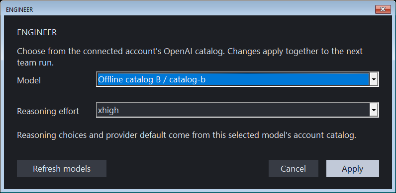

# Studio team workflow

Open **Assistant** in Studio and choose **Team**. The team shares the open
document and the selected Assistant account/endpoint. **Agents** selects three
to eight roles (eight by default): one orchestrator, one physics reviewer and
one to six part designers. Each has an independent conversation:

| Role | Responsibility | Document permission |
| --- | --- | --- |
| Orchestrator | Assembly placements, mates, integration and decisions | Assembly writes using observed revision |
| Part designers (up to six) | Actual parts, sketches, dimensions, materials and fabrication intent | Part/sketch writes using observed revision |
| Physics reviewer | Actual calculations, geometry checks and measured revision proposals | Read and propose corrections |

Saved role IDs remain `engineer`, `designer` and `reviewer`, so existing model
and effort settings retain their owners. Additional designers use `designer2`
through `designer6`. The runtime enforces each role's scope. The orchestrator
starts first and assigns distinct components with `team_send`. Specialists
await assignments, report created IDs/datums/evidence and return to idle.
Their completion messages wake the orchestrator to integrate the assembly.
Cards use up to two rows with paging on smaller displays; all configured
agents can run concurrently regardless of the visible page.

Each card's **Settings** selects a model and reasoning effort for that role.
In ChatGPT-plan mode these are native drop-down lists populated from the selected
account's model catalog. Opening settings loads missing catalog data; refreshing
fetches current choices. The model list preserves provider order and displays
the model name and slug. The effort list updates with the selected model's
advertised levels and shows its advertised default when available. No universal
effort list or model default is assumed.

Inheritance and **Auto** are explicit choices. Auto omits the reasoning field.
An inherited effort unsupported by a different selected model falls back to
Auto. Apply persists the role configuration for the next team run; Cancel
preserves the saved values. Unavailable models or unsupported explicit efforts
cannot be applied from the account selector. API-key/custom-provider settings
remain an explicitly advanced manual route rather than pretending the account
catalog describes a different endpoint.

The catalog is fetched through ARK's existing account connection using
`GET https://api.openai.com/v1/models`, without an inference call. Account
changes invalidate cached choices. See the official
[account-scoped model picker flow](https://developers.openai.com/siwc/token-sharing-open-source/models-and-inference).



Verified on 2026-10-10: the existing ARK account connection returned seven
visible models and their per-model effort lists/defaults, without inference.
Native UI tests cover selection, model-dependent effort lists, Apply/Cancel,
refresh, unavailable models, unsupported inheritance, empty/error responses,
account changes and Enter/Escape behavior in open drop-downs.

Send a goal with **Start** or Ctrl+Enter. Cards show actual runtime state,
provider requests, tool activity, role token totals and the latest messages.
Roles communicate with `team_send` and inspect `team_context`. The reviewer can
submit a measured, revision-bound `team_propose` to the appropriate writer;
that writer inspects `team_proposal` and uses `team_apply_step` at the proposed
revision. The event log includes actual tool starts,
finishes, failures and messages. **Idle** means that role's current turn ended;
it is not evidence that the product is complete or manufacturing qualified.

While the team is running, enter another decision and choose **Queue**.
**To: entire team** can target one role instead. An active conversation receives
the decision before its next provider request. An idle recipient starts a new
turn. Requests have bounded conversation, event, mailbox and turn limits; a
rejected decision is reported explicitly. Late decisions invalidate writes from
an already in-flight response until the new input is consumed.

**Pause** gates subsequent provider requests and tools. It does not interrupt
an HTTP request or geometry operation already executing. **Cancel** requests
cancellation; already applied document changes remain. Finish or cancel active
work before changing mode or role settings. Switching to **Single** closes the
idle team. Changing the open document or connector invalidates the old team.

The runtime executes provider conversations concurrently. Studio marshals every
CAD call through its existing owning-thread queue, and the runtime serializes
the shared executor. Team writes must supply the model's observed
`expected_revision`; stale or missing revisions reject without automatic
rebasing. The single Assistant and team cannot run simultaneously.

Each atomic construction step creates at most one feature or placement, with at
most eight commands. Queued and executing steps identify their actual role and
step ID. Studio renders bounded `sketch.set`, `sketch.entity.set` and
`sketch.patch` intent as dashed, uncommitted drafts from captured sketch/plane
context. It never invents partial solids or geometry from private reasoning.
Unsupported driven/projected drafts or unresolved planes remain absent. On
success the real evaluated sketch appears with a solid role color; exact bodies
publish after native evaluation completes. The counter advances only when the
reported revision actually increases. Rejections clear their draft without
publishing geometry. Rendering does not read a worker-owned session.

Studio has no artificial provider-round or role-turn budget. Agents continue
until they finish, are paused/cancelled, or encounter an actual error. Hosts can
still opt into finite windows for tests. **Resume after error** retains tool
receipts after a provider interruption; successful current `doc_info` is
required before a new write. Incomplete provider responses execute no tools.
Response/context/memory bounds and provider limits remain separate from turn
budgets; cancel and revision/atomicity protections remain active.

Static source-owned onboarding is prepared locally once per role's topic set,
then inserted once at the beginning of its retained conversation. It contains
no document snapshot or concrete example revision. Relevant loaded topics are
reused across parts; only a missing topic needs `agent_onboard`. Every new
write still requires current document evidence. A stable prefix enables provider
cache reuse when available, without claiming every request is cached or free.
See [OpenAI prompt caching](https://developers.openai.com/api/docs/guides/prompt-caching).

Tokens come only from provider-reported usage. Each role has a separate
`studio_team_<role>` receipt in the document usage ledger; repeated snapshots update
the same receipt rather than counting it twice. Missing usage remains unknown
and makes totals a reported lower bound. Counts exclude
unreported external MCP consumption. Team usage is recorded only while the UI
owns the document, never while a geometry worker owns the session.

During an active CAD or catalog operation, the existing Studio owner overlay
keeps rendering while its worker exclusively owns the session. Input waits until
that operation returns. Team decisions and pause/cancel are cooperative at the
document, tool and provider boundaries; they do not interrupt executing geometry.

## Local resources and current price equivalents

The title strip displays local system/Studio CPU and RAM, the Studio process's
busiest GPU engine, and dedicated VRAM across matching adapters. Measurements
refresh once per second. CPU/RAM scope is explicit; OpenAI compute is remote
and is not measured here. Missing GPU counters display **N/A**. GPU engine
percentages are not added together. Studio RAM uses private working set where
available and labels the shared-page fallback in details.

Drawing token totals aggregate persisted document receipts and current team
snapshots without counting cumulative snapshots twice. Cost display refreshes
at one second intervals. Public official pricing is fetched asynchronously at
startup and when a fresh Assistant conversation/team session starts; **Refresh
public pricing rates** also requests an update. Click the title strip for fetch
time, sources, selected model rates and calculation scope.

USD values are current Standard API-equivalent short/long-context scenarios.
Credits are Standard purchased-credit equivalents. They are not an account bill,
remaining plan allowance, or actual account consumption. Historical receipts
use the currently fetched rates. Missing model/rates remain unpriced, rather
than free. Cache writes, request context, service tier and region are not
recorded; output already includes reasoning tokens once.

## Surfaces, fabrication and persistent iterations

The separate **Surfaces** ribbon provides exact extrude, revolve, sweep, loft,
fill, NURBS, semantic face extraction, plane trimming, offset, sewing and
thickening. Extraction selects one inspected semantic face from its exact
source. Trimming selects a datum or explicit origin/normal triples and a
positive/negative retained side. These operations preserve their original
source in feature history; the supported trim produces one connected open
face. The **Mesh** gallery keeps explicit B-rep sampling visible in its forms.

**Sheet Metal** includes original-blank jog and linked full-width sketch bend
forms, with add/edit/remove choices. **Model** frame controls expose endpoint
trim/extend, crossing-plane trim and declared weld geometry. Their forms submit
the same atomic, revision-guarded native programs described in
[frame and sheet operations](FRAME_SHEET_OPERATIONS.md). They do not establish
forming, weld or structural qualification.

**Manage > Iterations** shows persistent newest-first authoring nodes. Select a
node to inspect its actor/model routing labels, operation, motivation, UTC,
parent, restore origin and before/after SHA-256. Actor labels are caller-declared
provenance, not authenticated identities. **Restore selected** re-evaluates that
state, creates a new branch and increases the document revision; drawing token
receipts remain current. Restore uses the revision observed when opening the
list and rejects a changed document. Finish or cancel active assistant work
before restoring. History persists in the native drawing after save/load;
temporary Undo/Redo is separate.

## Discover every tool

Every module ribbon contains **All tools**. This opens a categorized gallery
with native live search, scrolling and direct specialist dialogs. The gallery
scrolls its category list separately when the available screen height is small.
The gallery and command palette use the same catalog, including operations such as
editing/removing sheet flanges, hems and stamps, native surface tools, frames,
electronics, motion relations, assembly controls and team settings. Search spans
all categories, even when one category is selected.

**Advanced CAD API** lists every tool advertised by the current kernel schema.
It shows the tool description and opens a JSON argument editor seeded from
required schema fields, including the current revision where applicable. It
does not invent meaningful geometry arguments: users supply the requested
identifiers, commands, dimensions or paths before execution. Actual structured
results appear in a result dialog. This provides access to inspections and
specialist operations that do not yet have dedicated forms.

## Reuse components

**Library** appears on the Model and Tools ribbons and in the **Components &
library** gallery category. Search the persistent local library by text,
category, declared standard, thread diameter/pitch, length or material. Choose
a result to inspect its recorded source, license, declared metadata and native
geometry evidence, or insert it into the current document using a placement
form. The current revision guards insertion. Additional instances reuse the
existing component definition, and existing visible parts remain represented.

**Import STEP into component library** copies a selected file into immutable
library storage and verifies its native geometry. Its form records component
name, category, known provenance, source URL, license, material and standard.
Blank optional fields remain unknown. Select `auto` only for a single-solid
source, `all` for an intentional compound, or an explicit zero-based body index.
Ingest does not replace the open document.

The default library location follows `ARK_COMPONENT_LIBRARY` or the local ARK
application-data folder. A directory can be selected in the forms. Component
source registry, public catalog search and bounded STEP download operations are
also discoverable in Advanced CAD API. Source/license metadata, standards and
nominal dimensions are declarations; stored B-rep validity is separate evidence.

Offline verification:

```powershell
out/native-release/Release/ark-studio.exe --self-test-assistant-ui --shot out/team-ui-smoke.png --settings-file out/team-ui-settings.json
```

The selftest uses three injectable local transports without provider calls. It
checks serialized edits, reviewer write rejection, role models/efforts, token
receipts, dynamic decisions, pause/resume/cancel and distinct toolbar icons.
It also verifies actual sketch drafts, anchor patches and exact surface commits,
retained continuation through bounded rounds, branch restore, extraction/trim
area, jog/sketch-bend forms, large-scene orbit/pan/zoom, missing pricing and
non-overlapping title controls at 1180, 1440 and 3440 pixels. It verifies
gallery coverage, native filtering, paging, routed specialist
dialogs, full API coverage and local STEP library ingest/search/insert/reuse.
The test uses an isolated library beside its output path. It writes `.team.png`,
`.sketch-icons.png`, `.tool-gallery.png`, `.tool-search.png` and
`.tool-gallery-laptop.png` at 1280 by 720, plus
`.library-search.png` screenshots beside the main shot. The team screenshot is
explicitly labeled as an offline test.

## Navigation and pricing completion

Middle-button drag rotates the visible model in the pointer's direction using
relative motion. Rotation continues beyond the viewport/old virtual-sphere rim
and across both poles, with no positive or negative turn limit. **Alt + middle
drag** spins around the viewing axis; Shift + middle drag pans; the wheel zooms.
Left click selects; explicit Pan/Zoom tools and view-cube dragging remain
available. Named views reset roll. Rendering, picking, Fit and the cube use the
same camera basis. The context-menu focus action is named **Spotlight**.

The geometry progress message pump now dispatches pricing and team events
instead of discarding them. This fixes a completed fetch remaining at
`rates loading` and preserves live step/usage notifications during kernel work.
The integration test injects a pricing result during a real worker operation.

## Actionable rejected-operation feedback

The author receives the complete structured tool result in its next model
request. Teammates now also receive a compact rejection diagnostic, and
`team_context.roles[].last_tool_failure` retains the latest error evidence for
each role. UI ToolEnd events include the cause instead of only "returned error".
The revision and `document_unchanged` fields remain the tool's actual receipt;
an unknown execution outcome is never relabeled as a successful rollback.

The single-solid native contract reports `NATIVE_SINGLE_SOLID_REQUIRED`, the
observed solid count and advisory `recovery` guidance: inspect existing inputs,
use separate assembly instances for separate parts, or revise contact/cutter
geometry if the intended result is one body. A rejected output ID may not exist
in the committed document. Agents retain the choice of design correction;
no geometry is discarded, no tolerance is widened and no extra editing gate
is introduced. Diagnostics guide iteration rather than certifying the design.
