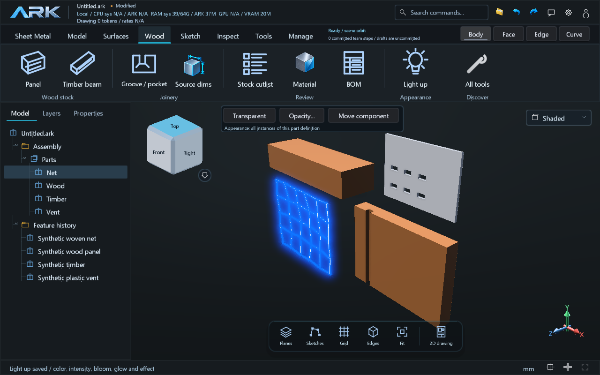
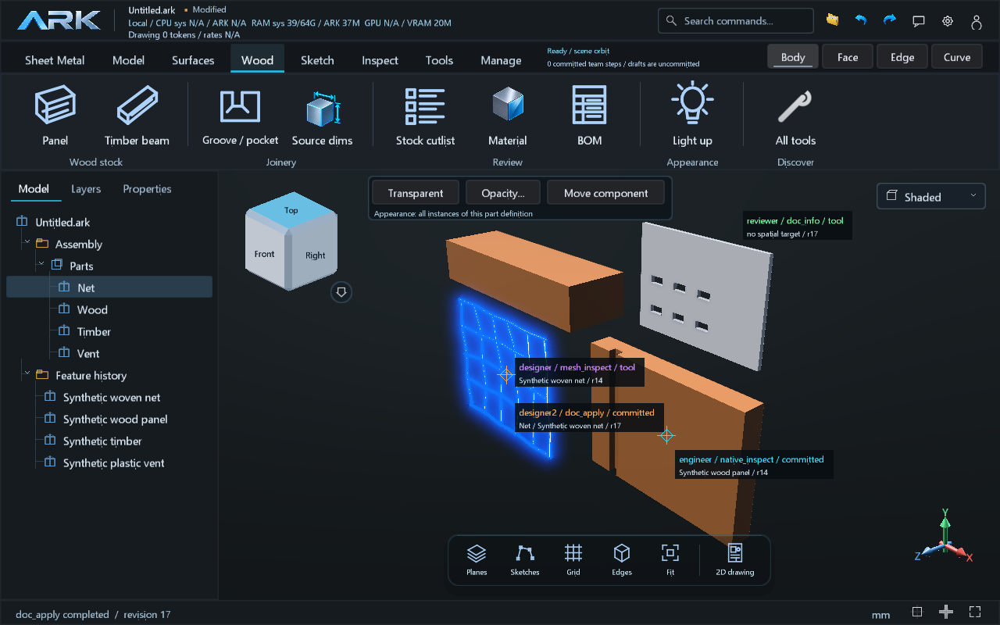
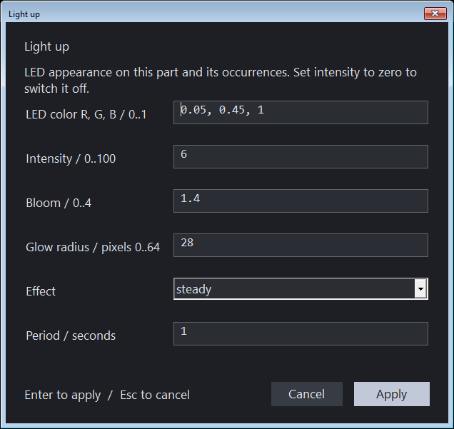

# Wood, networks, vents and Light up

030D develops **B.01/B.02/B.03/C.01/C.03/D.02/D.04/E.01**. These are scoped
authoring and display tools; broader milestones remain **Parcial**. Application
identity comes from `release.json`. New recipes conditionally select document
source **42**; ordinary older recipes retain their existing format. Containers
and undo/redo retain the required source version.

## Light up

Select a body, surface, mesh or an exact face, then search **Light up** in All
tools. The dialog controls color, intensity, bloom, glow radius, steady/pulse/blink
and period. Body appearances apply to all occurrences of that definition. Exact
face selection retains its observed semantic name and B-rep digest.

Agents load `agent_onboard{topic:"lighting"}`. At the current `expected_revision`:

```json
{"op":"light_up","id":"LED strip","appearance":{
  "emission_color":[0.05,0.45,1],"emission_intensity":6,
  "bloom":1.4,"glow":28,"emission_effect":"pulse","emission_period":2
}}
```

Intensity is relative, **0–100**; zero switches emission off. Bloom is **0–4**,
glow is **0–64 physical viewport pixels**, period **0.05–3600 seconds**. RGB is
sRGB **0–1**. Shared material emission uses `material.set`; exact regions use
`light_up` with `face` and `source_topology`. Individual Light up controls merge
into existing emission/appearance and preserve the material. Generic
`face_appearance.set` still replaces the entire region recipe.

The raster renderer adds emission before tone mapping, then filters a separate
HDR emitter mask using actual scene depth. Brightness and halo are separate
controls. This is a display effect, without calibrated lumens, electrical power,
light transport or illumination of neighboring parts. Studio viewport snapshots
capture it; the headless software snapshot does not reproduce it. The optional
path tracer selects raster display for emissive materials. No geometry changes.

## Nets and fabric

**Tools → Mesh net** creates an editable local XY network of capped triangle
tubes. Agents load `agent_onboard{topic:"networks"}`:

```json
{"op":"feature.add","type":"mesh_net","name":"Woven fabric",
 "p":{"width":120,"depth":100,"rows":8,"columns":10,
      "radius":0.5,"sag":8,"weave":1}}
```

Expressions stay in feature history and recompute after parameter edits. Rows
and columns are integers **2–64**; strand radius stays below **24%** of pitch.
`weave` is **0/1**. Sag defines the nominal shape rather than solving mechanics.
These are authored meshes: inspect with `mesh_inspect`. Cross-strand contact,
self-intersection, cloth mechanics, stretching and fabrication are unqualified.

## Vents

**Tools → Vent** creates a local XY solid grille, suitable for an explicitly
chosen plastic or other material. Its native operation is:

```json
{"op":"feature.add","type":"native_solid","name":"Grille",
 "native":{"op":"vent","kind":"slot"},
 "p":{"width":110,"depth":70,"height":3,"rows":3,"columns":5,
      "pitch_x":18,"pitch_y":18,"opening_width":12,"opening_depth":6,
      "x":14,"y":14}}
```

`rectangle`, `circle` and horizontal `slot` support at most **128** interior,
non-touching openings. X/Y identify the first center. Circles require equal
opening dimensions; slots require length greater than diameter. An optional
source input must be one exact pristine rectangular solid occupying the declared
local stock bounds.
The source B-rep and explicit program select geometry; no mesh fallback exists.
`native_inspect.report.vent` records counts and actual removed volume.

For sheet parts use **Sheet Metal → Vent**, retaining panel-owned openings:

```json
{"op":"sheet.vent","id":"Sheet grille","name":"Vent row","panel":"base",
 "rows":2,"columns":3,"pitch_x":20,"pitch_y":20,
 "opening":{"kind":"window","x":15,"y":15,"width":10,"height":5}}
```

Existing sheet opening circle/slot/window contracts apply. Circles use `radius`,
slots `length`/`width`, and windows `width`/`height`. The `name` identity prefix
uses ASCII letters, digits, dot, underscore or hyphen. Sheet vents reuse existing
opening storage and alone do not introduce source42. Dimensions and
spacing retain expressions; counts are integer literals. Each opening has a
stable `name.row.column` ID and remains editable through sheet opening commands.
Duplicate IDs, overlaps, outside-panel cuts and invalid recomputation reject
atomically. Flat/refold authority remains with the authored sheet. Vents are
openings; formed louvers and airflow calculations require further work.

## Wood

The **Wood** module starts with **Panel**, **Timber beam**, **Groove / pocket**,
**Source dims**, **Stock cutlist**, **Material** and **BOM**. Furniture and panel
work comes first; timber uses the same editable stock contract.

Agents load `agent_onboard{topic:"wood"}`:

```json
{"op":"feature.add","type":"native_solid","name":"Wood panel",
 "native":{"op":"wood","grain_axis":"x","joinery":[
   {"kind":"groove","x":20,"y":0,"width":8,"depth":400,"cut_depth":6}
 ]},"p":{"width":600,"depth":400,"height":18}}
```

Dimensions are local XYZ mm expressions. Grain direction is explicit **x/y/z**
metadata. Rectangular top-face pockets remain inside stock; rabbets meet a stock
edge; grooves may reach an edge. Cuts stay below the thickness. Each exact result
must be a valid positive-volume single solid; no disconnected piece is discarded.
Species, density, finish and structural material properties require explicit
inputs; the default brown appearance is a visual preset.

`wood_inspect` returns `ark.wood-cutlist.v1`, with blank dimensions, grain,
source identity and actual BOM occurrence quantities, including hidden copies.
Supported single-input rigid/machining descendants retain their Wood lineage.
This is a stock list: it does not add machining allowance, optimize sheets,
validate joint fit or calculate structural strength. General dovetails, angled
joinery, hardware catalogs, anisotropic analysis and cloth simulation remain
future work. Revit and Blender are workflow references, without an implemented
external adapter or parity claim.

## Agents in the viewport

**Tools → Presence**, also in All tools, toggles the overlay and saves that UI
preference. Each role has a stable color. Target reticles and labels show tool,
phase, target and observed revision. Feature IDs and assembly occurrence IDs have separate
namespaces; a newly placed occurrence uses the actual created-node receipt.
Absent or ambiguous targets remain unlocated. Explicit tool points/directions and real
feature/sketch identities locate the work. Queued drafts, applying operations,
measured commits and rejected steps stay distinct. An operation without a known
spatial target says so; the renderer does not invent a location.

The busy viewport reads captured positions and draft UI buffers while the model
worker owns CAD. The normal viewport resolves targets against the displayed
occurrences. Markers expire after 15 seconds without events. Focused remains the
default; Parallel remains optional. This overlay adds no provider request or
turn/token budget. It demonstrates visible local activity, not networked human
collaboration or a measured inference speedup.

## Development binary loop

```powershell
./scripts/dev-build.ps1 -Target Both -Verify
```

This uses CMake's incremental target graph and existing OCCT SDK, builds Studio,
MCP and the selected test executable, and runs the named focused CTest scope.
The timestamped receipt records source digest before/after, HEAD, identity,
phase timings, test status and executable SHA-256/size. Failed attempts retain
logs and failed receipts. Without `-Verify`, the receipt says the build has no
tests. This loop does not publish, replace a release or qualify distribution.

030D also supplies the SDK MSAA annotation GUID definitions in a dedicated
translation unit. The 029B hosted Windows jobs failed at this link boundary:
`CLSID_AccPropServices` and `PROPID_ACC_NAME`, even with the existing import
libraries. [The actual run](https://github.com/CenturyMesh/Ark/actions/runs/38768029936)
has successful Linux native/portable jobs and failed Windows linking. A local
correction does not turn that historical run green; hosted revalidation remains
separate.

## Inspected Studio captures

These are actual Windows Studio pixels from synthetic scratch geometry. The
role markers are exercised by the local host test, including real tool calls,
receipt-bound placements and synthetic state events; these images are not a
live-model design-quality benchmark.






