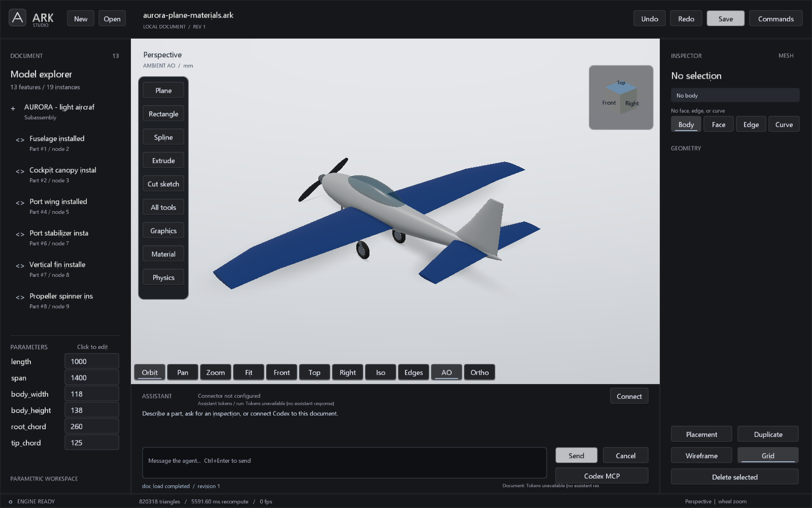

# Studio materials, rendering and physical properties

Studio uses a real-time OpenGL raster renderer. Material lighting uses a
metallic/roughness BRDF, linear-light evaluation of sRGB colors, and tone
mapping. Local image textures are projected in three directions in part
coordinates, so they follow an assembly instance without requiring authored
UV coordinates. Texture scale is repeats per 100 mm along each projected axis.
Embedded `texture_asset` images tile with repeat wrapping. 044B adds procedural
patterns (twill, weave, carbon, leather, brushed, knurl, perforated) that need no
image, with period, angle, contrast and optional secondary color, plus animated
GIF/video textures; see [044B media and patterns](MEDIA_TEXTURES_044B.md).
Transparent bodies use a sorted blended pass and do not act
as opaque occluders in the screen-space AO buffer.

Select a body and choose **Material** to assign or edit its named material,
color, metallic factor, roughness, opacity, image path, texture scale and the
044B procedural pattern, period, angle and contrast.
Aluminium, steel, ABS, rubber and glass presets provide editable nominal
densities. Editing a named material changes every feature using that material.
Use a new material name for an independent variant. Material definitions and
feature overrides persist in the `.ark` document; image files remain external.
Relative texture paths resolve beside the open document.

For interiors, the selected-body **Transparency** control toggles a persistent
feature opacity override; **Opacity** accepts a value from 0 to 1. This affects
all instances of that feature definition. Use a separate definition when one
copy needs an independent appearance. Restoring opacity 1 makes it opaque;
editing the named material instead affects all assigned features. Save and
undo/redo preserve the change without recomputing the B-rep.

Agents use `feature.edit{id,appearance:{opacity:0.25}}` with the observed
`expected_revision`. Appearance replaces the feature's override object; preserve
its other override fields when adjusting opacity. `appearance:null` clears the
whole override and restores the named material appearance.

**Graphics** controls occlusion mode, strength and radius, background, edge
display, projection, and construction-plane visibility. **AO** cycles Off,
Contact, Ambient and Horizon modes. Contact uses a smaller sampling region;
Ambient samples the local hemisphere; Horizon adds longer directional probes.
Construction datums are hidden by default and can be enabled for modeling.
Camera controls and the labelled view cube remain available during modeling.

**Physics** inspects the selected exact part, or the visible assembly when no
part is selected. It reports density, mass, weight and center of mass. A part
centroid is in its definition coordinates; an assembly centroid is in world
coordinates. Results are refreshed on request and invalidated when selection
or document revision changes. Values come from OCCT volume properties and
declared densities. Pattern copies and their transforms contribute separately.
Missing densities prevent a complete total rather than being treated as zero.
The assembly scope is explicitly `visible_placed_parts`; hiding a part excludes
it from that scope. Overlapping parts are counted independently.

For agents, call `agent_onboard` with `topic:"materials"`. `material.set` and
`feature.edit` use the same transactions as the UI. An appearance-only batch
returns `geometry_recomputed:false` and retains exact geometry. `native_inspect`
and `assembly_info` accept `gravity_m_s2` (default 9.80665) and return `mass_g`,
`mass_kg`, `weight_N`, `center_mm`, and `mass_checked` when supported.

This is a viewport improvement, not a ray-traced renderer or a claim of Fusion
rendering parity. Screen-space occlusion cannot see off-screen geometry, and
sorted transparency does not model refraction or arbitrary intersecting glass.
The MCP `snapshot` tool is a flat-lit software preview: since 044B it draws
triplanar textures, pattern colors and surface stamps, but not PBR response or
bump relief; use Studio captures to review materials. Exact STEP geometry is independent of appearance.
Material density does not establish structural strength or simulate dynamics.

The [AURORA materials example](../examples/aurora-plane-materials.ark) assigns
nominal bulk densities to conceptual volumes. Its solid canopy and foam-filled
airframe are display/modeling assumptions, not an aircraft weight specification.
The [replay](../examples/aurora-plane-materials.arkops) starts from the original
plane and uses copy-only mirrors to place each wing once.

