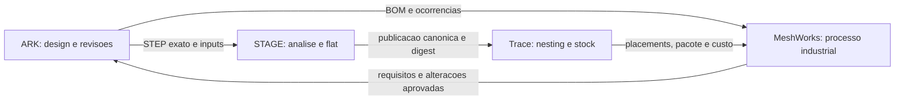

# ARK — matriz de roadmap A–G

**Data da auditoria:** 10 de outubro de 2026. **Iteração local:** `002B`.
O baseline entregue é `0.9.1`, commit `5e7153f`; não foi rebatizado retroativamente.
`001A` inicia a convenção pública, com versão técnica `0.9.2` para distribuição.
`002B` acrescenta recuperação do runtime, projeção exata e ferramentas de frame;
ver [escopo e evidência](iterations/002B.md). Os milestones abaixo mantêm os seus
gates completos mesmo quando uma parte já foi verificada.

**Visão:** um ambiente CAD onde uma pessoa ou uma equipa de agentes consegue
transformar uma intenção num produto editável, verificável e preparado para
industrialização, conservando a ligação entre design, geometria, fabrico e custo.

O objetivo não é anunciar paridade imediata com SolidWorks, CATIA ou Fusion.
É construir uma alternativa credível para peças, assemblies e produtos
fabricáveis, diferenciada pela continuidade ARK → STAGE → Trace → MeshWorks.

## Como ler a matriz

- A–G são conjuntos estáveis de milestones. Podem avançar em paralelo quando
  as dependências o permitirem; a letra de uma versão identifica o seu foco principal.
- IDs como `C.03` identificam trabalho; códigos como `012C` identificam uma iteração.
  Os três dígitos são globais e sequenciais. O mês não participa no código.
- **Verificado no escopo** significa que existe evidência para um domínio concreto.
  **Parcial** significa que existe implementação útil, com critérios ainda em falta.
  **Planeado** não é uma promessa de funcionalidade entregue.
- Datas abaixo são horizontes de planeamento a partir da decisão de execução,
  não prazos contratados. Cada ciclo deve acabar num incremento utilizável e medido.

## O que o ARK já tem

Inventário baseado em código, contratos e recibos locais. Os 52 CTests e 12 testes
de interface do baseline não certificam todos os modelos nem todo o fabrico.
Ver [evidência 0.9.1](verification-ark-0.9.1.json).

| Área | Já implementado | Limite que permanece |
|---|---|---|
| Kernel nativo | C++ e worker OCCT 8; B-reps, operações sólidas, referências semânticas e exportação STEP | Domínios suportados e referências ambíguas podem rejeitar; não é paridade completa com um CAD industrial |
| Sketch paramétrico | Entidades nomeadas, dimensões/expressões, constraints, diagnóstico de resíduos e DOFs | Robustez e experiência de edição ainda precisam de corpus de utilização real |
| Sólidos e superfícies | Primitivas, extrude, loft/sweep, booleanos, acabamento e operações de superfícies/NURBS | Não há qualificação de superfícies Class A nem conversão genérica mesh→B-rep garantida |
| Assembly | Definições/instâncias, grupos, placements, mates, referências, BOM e diagnóstico | Grandes assemblies, referências externas e alterações coordenadas precisam de evolução |
| Movimento | Cadeia/engrenagens/eixos/rack/cam e suspensão em previews cinemáticos | Não equivale a dinâmica multicorpo validada, contacto real ou FEA |
| Chapa | Programa de painéis/flanges/aberturas, formado/plano, jog/sketch bend dentro do domínio documentado | Importação e formas complexas continuam limitadas; sem springback/tool-access geral |
| Estruturas soldadas | Tubos, stock/cutlists, cope, trim/extend e cordões exatos em casos suportados | Não há garantia geral de juntas arbitrárias ou qualificação de soldadura |
| Engenharia física | Materiais, massa/CG/inércia e cálculos analíticos com hipóteses explícitas | Não existe solver FEA geral ou certificação mecânica do produto |
| Eletrónica mecânica | Layout PCB, cabos e verificações geométricas de obstáculos | Não substitui ECAD, validação elétrica, EMC ou preparação industrial de PCB |
| Documento | `.ark` binário, histórico persistente, undo/redo, branches de restauração e revisões | Recuperação operacional, colaboração remota e migrações de longo prazo têm trabalho por fazer |
| Biblioteca | Catálogo local SQLite/FTS5, aquisição/validação de STEP e proveniência | Catálogos de fornecedores, licenças de conteúdos e gestão de versões ainda são incompletos |
| Agentes | Focused com engenheiro/designer/reviewer; Parallel até oito; contexto reutilizável e erros estruturados | Não há benchmark que demonstre melhor design ou menor custo em tarefas equivalentes |
| Acesso aos modelos | Conta ChatGPT elegível e API key; consumo reportado e catálogo de preços | Créditos dependem das permissões da conta; valores ausentes não são custo zero |
| Automação | MCP local, bridge para documento aberto, inspeção e escrita com revisão observada | Permissões remotas, SDK de extensões e automação industrial ainda não estão completos |
| Interface | Ribbon, ferramentas pesquisáveis, Spotlight, materiais/rendering, cubo, orbit e cards | Acessibilidade, desenho 2D, grandes projetos e consistência de interação precisam de evolução |
| Distribuição | Pacote Windows, integridade, staging, próximo arranque e rollback de self-update | Canal online do futuro site ainda não está ligado; publicação e assinatura comercial estão pendentes |

Contratos de referência: [CAD nativo](ROADMAP_09.md), [superfícies](SURFACING.md),
[chapa e frames](FRAME_SHEET_OPERATIONS.md), [engenharia](ENGINEERING_AGENT_V2.md),
[documento](DOCUMENT_CONTAINER.md), [histórico](ITERATION_HISTORY.md),
[agentes](AGENT_TEAM_ARCHITECTURE.md) e [updates](UPDATES.md).
O documento ROADMAP_09 é um registo histórico; esta matriz passa a orientar o futuro.

## Matriz principal

| Fase | Resultado pretendido | Ponto de partida | Gate para declarar a fase verificada |
|---|---|---|---|
| **A — Confiança e fundação** | Trabalhar durante dias sem perder trabalho ou confundir versões | Persistência, transações, testes e rollback locais | Recuperação testada, identidade inequívoca, regressões reproduzíveis e baseline de desempenho |
| **B — Autoria CAD competitiva** | Criar e alterar um produto completo com fluidez | Sketches, sólidos, superfícies, assemblies e viewport úteis | Corpus de edição paramétrica, grandes assemblies e documentação técnica utilizável |
| **C — Engenharia e fabrico** | Ligar decisões de design a geometria e processo verificáveis | Chapa/frames e cálculos dentro de domínios limitados | Peças físicas representativas com contrato, medições, rastreabilidade e limites declarados |
| **D — Agentes de design eficazes** | Chegar a um bom design com custo e tempo explicáveis | Equipa real, Focused/Parallel e feedback de ferramentas | Comparação reproduzível com resultados válidos, qualidade avaliada e custo por design aceite |
| **E — Ecossistema industrial** | Um fluxo rastreável entre ARK, STAGE, Trace e MeshWorks | Produtos separados; contratos de integração parcialmente disponíveis | E2E com identidade/revisão/digest preservados, incluindo rejeição, retries e rollback |
| **F — Produto e negócio** | Vender, instalar, atualizar e suportar ARK de forma sustentável | Aplicação local e self-update preparado | Piloto pago, termos claros, pacote auditado e canal de updates comprovado |
| **G — Plataforma avançada** | Explorar alternativas e colaborar à escala de um produto complexo | Histórico, automação e superfícies servem de base | Casos avançados medidos, extensões estáveis e colaboração sem perda de autoridade geométrica |

## Milestones e critérios de aceitação

### A — Confiança e fundação

| ID | Milestone | Estado inicial | Aceitação e dependências |
|---|---|---|---|
| A.01 | Identidade `NNNF`, registo de iteração e regras obrigatórias | Verificado no escopo `001A` | `release.json` validado; código consistente na app, MCP, onboarding e pacote; 26 casos de identidade e testes de exposição; ver [registo](iterations/001A.md) |
| A.02 | Recuperação e proteção de trabalho | Parcial | Crash durante save/modelação/update, disco cheio e ficheiro truncado preservam a última revisão íntegra; autosave recuperável sem substituir o original |
| A.03 | Corpus de regressão e cadeia de release | Parcial | Casos positivos/negativos públicos ou autorizados, seeds e hashes; suites nativa/UI/persistência/OTA; recibo por artefacto; CI demonstrada |
| A.04 | Desempenho observável | Parcial | Medir cold/warm open, save incremental, p95 de interação e recompute em três tamanhos de projeto; comparar à mesma baseline e equipamento |
| A.05 | Segurança e dependências | Parcial | SBOM de software, avisos de terceiros, origem dos binários, assinatura e política de vulnerabilidades; sem incluir credenciais/desenhos nos pacotes |

### B — Autoria CAD competitiva

| ID | Milestone | Estado inicial | Aceitação e dependências |
|---|---|---|---|
| B.01 | Navegação e edição legíveis | Parcial; refinamento em `001A` | Cubo persistente, setas/letras sem fundo, orbit livre, seleção/Spotlight, atalhos e DPI; controlos sem cortes nas resoluções suportadas |
| B.02 | Sketch e feature tree de uso diário | Parcial; projeção associativa em `002B` | Diagnóstico acionável, edição de constraints, reordenação quando válida, suppress/rollback e dependências visíveis; rejeições sem dano ao documento |
| B.03 | Sólidos e superfícies avançados | Parcial; inclusão espacial exata em `002B` | Loft/sweep/guias, continuidade medida, patches/trim/thicken e reparação explícita em corpus difícil; não mascarar falhas com meshes |
| B.04 | Assemblies grandes e configuráveis | Parcial | Subassemblies, instâncias reutilizadas, configurações, referências externas e carregamento seletivo; atualizar 1 definição sem duplicar as N ocorrências |
| B.05 | Desenhos técnicos e intercâmbio | Planeado | Vistas associativas, cortes, cotas/tolerâncias, BOM e exportações com readback; medir perda de informação em STEP/IGES/DXF e no formato nativo |

### C — Engenharia e fabrico

| ID | Milestone | Estado inicial | Aceitação e dependências |
|---|---|---|---|
| C.01 | Chapa industrial com STAGE | Parcial local; integração planeada | STEP exato + inputs explícitos → publicação canónica ou rejeição; corpus acordado, refold/flat e material rastreáveis; depende de E.01/E.02 |
| C.02 | Weldments completos | Parcial; edição via instâncias corrigida em `002B` | Trim/extend multi-membro, juntas, preparação, cordões e cutlists coerentes; desenhos e comprimentos derivados do resultado exato |
| C.03 | DFM por processo | Parcial | Regras versionadas para laser/dobra/FDM/CNC/solda, hipóteses e evidência por peça; recomendações separadas de certificação |
| C.04 | Verificação estrutural e movimento | Parcial analítico; FEA planeado | Load cases e unidades, comparação com soluções analíticas, convergência de malha e solver externo auditado; contacto/fadiga só após validação própria |
| C.05 | Pilotos físicos de referência | Planeado | Fabricar uma caixa de chapa, uma estrutura soldada e um pequeno assembly; medir desvios, montagem, custo e tempo; fechar o ciclo com revisões do design |

### D — Agentes de design eficazes

| ID | Milestone | Estado inicial | Aceitação e dependências |
|---|---|---|---|
| D.01 | Benchmark de qualidade/tempo/custo | Planeado; prioridade imediata | Pelo menos 30 briefs versionados, três repetições por configuração inicial e avaliação humana cega; medir custo por design aceite, não só tokens por turno |
| D.02 | Engenheiro responsável e equipa adaptativa | Parcial; onboarding/permissões e overhead corrigidos em `002B` | Comparar Single, Focused e Parallel; especialistas só com missão útil; paralelismo escolhido por benefício medido; sem budgets impostos por defeito |
| D.03 | Espaços de trabalho por peça | Planeado | Agentes editam branches isolados com ownership e datums; integração transacional identifica conflitos geométricos e de revisão sem rebase silencioso |
| D.04 | Feedback multimodal e autocorreção | Parcial; previews e métricas em `002B`; pixels pendentes | Mesmo diagnóstico chega ao autor/reviewer; previews ligados à revisão; ciclos de erro repetido detetados; correção preserva intenção e referências |
| D.05 | Alternativas de conceito e conhecimento reutilizável | Parcial no onboarding | Comparar alternativas por requisitos, massa, custo/processo e preferência humana; biblioteca de exemplos validados; nunca chamar a uma proposta uma peça criada |

### E — Ecossistema industrial

| ID | Milestone | Estado inicial | Aceitação e dependências |
|---|---|---|---|
| E.01 | Identidade e contrato comuns | Planeado | IDs de documento/parte/ocorrência/revisão, unidades, source hash, geometry digest, proveniência e idempotência; schemas versionados e testes de compatibilidade |
| E.02 | ARK ↔ STAGE | Planeado | Publicar e consumir artefactos por contrato; preservar source, corpo, opções e versão do produtor; apresentar rejeição sem geometria substituta |
| E.03 | ARK ↔ MeshWorks | Planeado | Adapter `ark` explícito e autorizado; BOM incremental com quantidades e configurações; revisões CAD não apagam procurement/release; não fingir ser SolidWorks |
| E.04 | STAGE/ARK ↔ Trace | Planeado | Contornos canónicos entram por result_id/digest; retornam placements/stock/utilização/package; grain, kerf e unidades explícitos; consumo de stock é ação separada |
| E.05 | Piloto de digitalização ponta a ponta | Planeado | Design → revisão aprovada → flat → nest → pacote → BOM/custo/produção; testar alteração de peça, revogação, retry, rejeição e remanescente sem efeitos duplicados |

### F — Produto e negócio

| ID | Milestone | Estado inicial | Aceitação e dependências |
|---|---|---|---|
| F.01 | Self-update pelo futuro site | Parcial | Integridade/staging/rollback já locais; falta transporte real, assinatura, canais stable/preview, rollout gradual e rollback testado com release publicada |
| F.02 | Licença perpétua de aproximadamente 200 € | Proposta | Definir direitos, IVA, utilizador/dispositivo, offline, atualizações e suporte; validar disposição a pagar com pilotos; ver estratégia comercial |
| F.03 | Onboarding e biblioteca inicial | Parcial | Instalação limpa, primeiros cinco workflows guiados e templates fabricáveis; medir tempo até primeira peça válida e taxa de abandono |
| F.04 | Suporte e qualidade operacional | Planeado | Crash reports opt-in sem desenhos, logs redigidos, diagnóstico exportável, migrações e matriz de hardware; política de suporte compatível com preço baixo |
| F.05 | Piloto comercial e distribuição | Planeado | Coorte inicial de 10–20 utilizadores reais, feedback e incidências tratados; funil de compra/ativação/recuperação claro; não prometer updates/suporte ilimitados sem modelo económico |

### G — Plataforma avançada

| ID | Milestone | Estado inicial | Aceitação e dependências |
|---|---|---|---|
| G.01 | SDK e extensões estáveis | Planeado | APIs tipadas, contratos e exemplos; sandbox/permissões; compatibilidade entre duas versões; separar SDK aberto de licença ainda por decidir do produto |
| G.02 | Colaboração e revisão distribuída | Planeado | Comentários, diffs geométricos e aprovação por revisão; replay determinístico e resolução de conflitos; isolamento de dados entre organizações |
| G.03 | Exploração paramétrica multiobjetivo | Planeado | Pesquisar variantes por massa, rigidez, custo e fabrico em domínios validados; soluções viáveis antes de ranking; comparação com baseline humana |
| G.04 | Portabilidade e execução remota | Parcial no core; produto planeado | Qualificar Linux/native OCCT, workers remotos e eventual macOS separadamente; mesmos contratos e resultados com provas por plataforma |
| G.05 | Produto virtual verificável | Planeado | Assembly, materiais, cargas, movimento, fabrico e custo ligados por revisão; alterações propagam invalidando provas antigas; pilotos mostram valor operacional mensurável |

## Responsabilidades entre os quatro produtos

Fluxo-alvo **a implementar e qualificar**:

| Produto / snapshot inspecionado | Autoridade principal | O que o ARK deve trocar |
|---|---|---|
| ARK / `main@5e7153f` | Intenção paramétrica, edição, partes, assemblies, revisões e interação com agentes | `.ark`, STEP exato, BOM de design, requisitos, referências e evidência |
| STAGE / `Engine RC0326@87d45c1a` | Análise/desenvolvimento source-owned e publicação canónica no domínio qualificado | Source hash, corpo, inputs, artefacto/result_id, geometry digest e rejeições tipadas |
| Trace Nest / `agent/alpha-prototype@8167152a` | Posicionamento e validação de nesting, stock/remanescentes e pacote de corte | Contornos da publicação original, placements, utilização, custos e identidade de stock |
| MeshWorks / `main@0d4dcfa5` | BOM empresarial, revisão/release, procurement, CPQ, qualidade e produção | Documento/parte/ocorrência estáveis, quantidades local/total, materiais e estados de revisão |

STAGE é **SOLID TOPOLOGY ANALYSIS & GEOMETRY ENGINE**. A etapa Stage 14 é um
validador dentro desse trabalho, não outro produto.

O adapter CAD de MeshWorks executa atualmente SolidWorks; ARK precisa de adapter
próprio. Trace permanece alpha, com `optimality_proven:false` e
`manufacturing_qualified:false`. O estado de STAGE ainda separa publicação/API,
comparação DXF estrita, corpus, CI e promoção de release. Não herdar um selo
“pronto para produção” por ligar uma API.

Evidência cruzada, consultada apenas em leitura, sem testar deployments:

- [Identidade STAGE](../../Engine/docs/beta/KERNEL_STUDIO.md) e
  [estado do Engine](../../Engine/docs/beta/ENGINE_STATUS.md).
- [Payload CAD MeshWorks](../../Meshworks/src/lib/cadIntegrationPayload.ts),
  [gate do adapter](../../Meshworks/supabase/functions/cad-integration/index.ts) e
  [maturidade SBOM](../../Meshworks/docs/SBOM_MATURITY_PORT_PLAN.md).
- [Contrato Trace](../../Trace%20Nest/docs/CANONICAL_INTEGRATION.md) e
  [adapter canónico](../../Trace%20Nest/src/trace_nest/adapters/canonical.py).

## Ordem de execução recomendada

| Horizonte indicativo | Entrega concreta | Milestones prioritários |
|---|---|---|
| Agora / primeiras 2–4 semanas | Identidade, UI clara, recuperação medida e benchmark inicial dos agentes | A.01–A.04, B.01, D.01–D.02 |
| 1–3 meses | Peças e assemblies editáveis de uso diário; primeiro adapter industrial isolado | B.02–B.04, C.02, E.01–E.02, F.03 |
| 3–6 meses | Piloto físico e fluxo flat/nest/BOM com cliente acompanhado | C.01/C.03/C.05, D.03, E.03–E.05, F.01/F.02/F.05 |
| 6–12 meses | Produto comercial repetível, desenhos técnicos e engenharia mais profunda | B.05, C.04, D.04–D.05, F.04, G.01 |
| 12–24+ meses | Plataforma distribuída e exploração multiobjetivo comprovada | G.02–G.05, com os gates anteriores demonstrados |

Os horizontes assumem uma equipa com responsabilidade contínua de produto,
engenharia e validação. Aumentar agentes não aumenta automaticamente essa capacidade.
Se houver capacidade limitada, priorizar uma cadeia vertical completa em vez de
abrir simultaneamente todos os módulos.

## Scorecard de cada ciclo

1. Percentagem de tarefas que acabam num documento válido e editável.
2. Tempo até primeira geometria útil e até design aceite.
3. Tokens/custo total por design aceite, incluindo falhas e coordenação.
4. Avaliação humana de função, forma, editabilidade e intenção de fabrico.
5. Crash-free sessions, recuperações bem-sucedidas e regressões de p95.
6. Continuidade de identidade e ausência de efeitos duplicados nas integrações.
7. Horas de suporte por cliente e margem por licença perpétua.

Primeiro benchmark: suporte usinado, caixa de chapa, estrutura soldada, pequeno
mecanismo e produto livre como bicicleta/drone. Misturar tarefas simples, alterações
de design e inputs deliberadamente inválidos. Seeds, modelos e esforço devem ficar
registados. Só comparar custo quando a qualidade e o critério de aceitação forem equivalentes.

## Decisões ainda abertas

- Licença do código próprio e política de contribuições: ver
  [estratégia comercial](COMMERCIAL_STRATEGY.md). Nada foi tornado público por este roadmap.
- Alcance dos 200 € perpétuos: versões elegíveis, suporte e IVA precisam de termos finais.
- Endpoint e assinatura do self-update do futuro site.
- Corpus e critérios conjuntos de qualificação de ARK/STAGE/Trace/MeshWorks.
- Capacidade real da equipa antes de converter horizontes em datas de compromisso.
