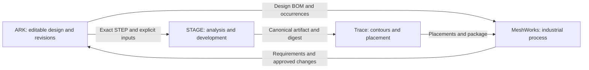

# ARK roadmap A–G

ARK aims to make an intention into an editable, inspectable design through a
workspace shared by people and agents. The next features must improve dependable
CAD authoring before claims of general industrial qualification.

The public iteration and numeric runtime are defined in
[release.json](../release.json). An iteration such as `016F` identifies the globally
increasing sequence and its principal phase. The letter is a roadmap phase, not a
month; it does not declare the phase complete. The `.ark` format evolves separately.

This matrix keeps the 35 stable milestone IDs from the
[12 October 2026 audit](history/ROADMAP-2026-10-12.md). That archive retains its exact
historical evidence, failed benchmark attempts, planning horizons and cross-product
snapshots. The English matrix summarizes the same acceptance boundaries with the
current source-publication preparation reflected in A.05/F.03/F.05.

## Read status and evidence correctly

The mandatory status vocabulary remains consistent with [AGENTS.md](../AGENTS.md):

| Status | Meaning |
|---|---|
| **Planeado** | Planned; acceptance has not been demonstrated |
| **Em curso** | In progress; implementation or qualification is underway |
| **Parcial** | Partial; useful implementation exists, with acceptance gates still open |
| **Verificado no escopo** | Verified for a stated domain, configuration and evidence |
| **Bloqueado** | Blocked by a named dependency or unresolved condition |

A local test, a mock provider, an API call, a deployment and a physically measured
manufacturing pilot establish different things. Every completion claim needs its
scope, inputs, commands, result and limitations. A screenshot or an idle agent is
not a delivery gate. No date or feature below is a contractual delivery promise.

## Available foundation

ARK currently provides a C++/OCCT exact-geometry path, parametric sketches and
features, semantic references, assembly instances and mates, supported motion,
authored sheet/frame domains, materials and analytical physics, persistent document
history, a local component library, BOM metadata/JSON export, Windows Studio and
local agent tools. [The handbook](HANDBOOK.md) and [contracts index](README.md)
explain how to use them.

Useful functionality does not imply complete parity with established CAD systems.
General FEA, arbitrary multi-bend imported-sheet unfolding, supplier catalog
coverage, associative technical drawings, remote collaboration and the industrial
adapters remain unfinished. Windows is the native desktop product. Linux CLI,
MCP and native OCCT worker are locally verified in 016F; Linux desktop support
remains unimplemented. Portable-core checks are a separate scope.

## A — Trust and foundation

Goal: work for days without lost work, ambiguous identity or unverifiable regressions.

| ID | Milestone | Status | Acceptance still governing the work |
|---|---|---|---|
| A.01 | Iteration identity and release records | Verificado no escopo | Validate `release.json`; expose one consistent identity in application, MCP, onboarding and packages. Preserve global sequence and runtime/document separation. [001A evidence](iterations/001A.md) |
| A.02 | Recovery and work protection | Parcial | Crash during save/modeling/update, disk-full and truncation tests preserve the last intact revision; recoverable autosave cannot replace the original silently. |
| A.03 | Regression corpus and release chain | Parcial | Authorized reproducible positives/negatives with seeds/hashes; native, UI, persistence and OTA suites; receipts for distributed artifacts; actual hosted CI execution. |
| A.04 | Observable performance | Parcial | Measure cold/warm open, incremental save, p95 interaction and recompute at three project sizes against the same machine/baseline. [012D scope](iterations/012D.md) |
| A.05 | Security, licensing and dependencies | Parcial | Apache-2.0 source license and dependency notices are adopted; source/publication inventory, software SBOM, binary provenance, signing and vulnerability handling need evidence. Never package credentials or user designs. |

## B — Competitive CAD authoring

Goal: create and revise a complete product with clear, reliable interactions.

| ID | Milestone | Status | Acceptance still governing the work |
|---|---|---|---|
| B.01 | Readable navigation and editing | Parcial | Stable cube/axes, free orbit, selection/Spotlight, shortcuts and DPI; no clipped controls at supported resolutions. Measurement and display units have [013B evidence](iterations/013B.md); BOM layout has [015B evidence](iterations/015B.md). |
| B.02 | Everyday sketches and feature history | Parcial | Actionable constraint diagnostics, valid reorder, suppress/rollback and visible dependencies; rejection leaves the document intact. Arcs/snaps/expressions have scoped 005B/008D evidence. |
| B.03 | Advanced solids and surfaces | Parcial | Difficult loft/sweep/guide/patch/trim/thicken corpus, measured continuity and explicit repair; no mesh fallback concealing exact failures. |
| B.04 | Large, configurable assemblies | Parcial | Subassemblies, reused instances, configurations, external references and selective loading; editing one definition updates all occurrences. Supported mechanisms are locally scoped. |
| B.05 | Technical drawings and exchange | Parcial | Associative views, sections, dimensions/tolerances and BOM; readback measures loss in STEP/IGES/DXF/native exchange. Local BOM/JSON is implemented; associative drawing work remains planned. [BOM contract](BOM.md) |

## C — Engineering and manufacturing

Goal: connect design choices to exact geometry and measured process evidence.

| ID | Milestone | Status | Acceptance still governing the work |
|---|---|---|---|
| C.01 | Industrial sheet workflows with STAGE | Parcial | Exact STEP plus explicit inputs yields a canonical artifact or typed rejection; agreed corpus, refold/flat and material traceability. Local sheet support exists; integration depends on E.01/E.02. |
| C.02 | Complete weldments | Parcial | Multi-member trim/extend, joints, preparation, beads and coherent cutlists; drawings and lengths derive from exact results. Scope/candidates/replay have [008D evidence](iterations/008D.md). |
| C.03 | Process-specific DFM | Parcial | Versioned laser/bend/FDM/CNC/weld rules, assumptions and per-part evidence; recommendations remain distinct from qualification. [Manufacturing intent](MANUFACTURING_INTENT.md) |
| C.04 | Structural checks and motion | Parcial | Units/load cases, analytical comparisons, mesh convergence and an audited external solver. Supported analytical/kinematic previews exist; FEA, contact and fatigue require separate validation. |
| C.05 | Physical reference pilots | Planeado | Fabricate a sheet enclosure, welded frame and small assembly; measure deviation, fit, cost and time; feed observations back into design revisions. |

## D — Effective design agents

Goal: reach valid, useful designs with explainable quality, time and total cost.

| ID | Milestone | Status | Acceptance still governing the work |
|---|---|---|---|
| D.01 | Quality/time/cost benchmark | Parcial | At least 30 versioned briefs, three repeats per initial configuration and blind human evaluation; cost per accepted design includes failures and coordination. Harness exists; 008D pilots were 0/9 and 4/9, 009B closed at 1/9. These results prove no savings. |
| D.02 | Responsible engineer and adaptive team | Parcial | Compare Single/Focused/Parallel; give specialists concrete useful assignments and choose concurrency by measured benefit. No default turn/token budgets. Context, completion and feedback have scoped iteration evidence. |
| D.03 | Isolated part workspaces | Planeado | Piece-level branches with ownership/datums; transactional integration identifies geometric/revision conflicts without silent rebase. |
| D.04 | Multimodal feedback and correction | Parcial | Shared author/reviewer diagnostics, revision-bound previews, repeated-error detection and intent-preserving correction. Real images, failure replay and transport projection exist within [008D](iterations/008D.md), [010D](iterations/010D.md) and [012D](iterations/012D.md) scopes. |
| D.05 | Concept alternatives and reusable knowledge | Parcial | Compare alternatives against requirements, mass, process/cost and human preference using validated examples. A proposal must not be reported as a created part. |

## E — Industrial ecosystem

Goal: preserve identity and evidence through ARK → STAGE → Trace → MeshWorks.

| ID | Milestone | Status | Acceptance still governing the work |
|---|---|---|---|
| E.01 | Shared identity and contracts | Parcial | Document/part/occurrence/revision IDs, units, source hash, geometry digest, provenance and idempotency; versioned schemas and compatibility tests. Local `ark.bom.v1` exists; cross-product reconciliation is planned. |
| E.02 | ARK ↔ STAGE | Planeado | Publish/consume by contract; preserve original source, body, options and producer version. Display rejection without substitute geometry. |
| E.03 | ARK ↔ MeshWorks | Planeado | Explicit authorized ARK adapter; incremental BOM quantities/configurations; CAD revisions preserve procurement/release state. Local BOM prepares input but no remote adapter is implemented. |
| E.04 | STAGE/ARK ↔ Trace | Planeado | Canonical contours identified by result ID/digest; placements, stock, utilization and package returned with explicit grain/kerf/units. Stock consumption remains a separate action. |
| E.05 | End-to-end industrial pilot | Planeado | Design → approved revision → flat → nest → package → BOM/cost/production; exercise change, revocation, retry, rejection and remnant custody without duplicate effects. |

The following is a **target integration flow**, not an implemented adapter claim:

Each product retains its own authority. Connecting an API does not transfer another
product's manufacturing qualification. The historical audit records the specific
cross-product source snapshots it inspected; those are not current deployment claims.

## F — Product and distribution

Goal: make ARK understandable, installable, updateable and supportable.

| ID | Milestone | Status | Acceptance still governing the work |
|---|---|---|---|
| F.01 | Trusted online self-update | Parcial | Local integrity/staging/next-launch/rollback exists. Qualify real transport, signing, stable/preview channels, rollout and rollback from a published older runtime. [Updates](UPDATES.md) |
| F.02 | Sustainable commercial offering | Planeado | Define any future paid services or Enterprise offering separately from the adopted Apache-2.0 source license; specify actual features, support, taxes and terms, and validate demand. The earlier approximately €200 perpetual model is a historical proposal. |
| F.03 | Onboarding and initial library | Parcial | English README/handbook, branch/PR guidance, a [first-part walkthrough](FIRST_TRY.md), structured experience reports and [launch materials](launch/README.md) are available. Clean-machine setup and five guided workflows still need observed first-valid-part time and abandonment evidence. Fabricable templates need their own qualification. |
| F.04 | Support and operational quality | Parcial | Contribution templates and security guidance support reporting; opt-in redacted crash reports, diagnostic export, migrations, hardware matrix and support policy need operational evidence. |
| F.05 | Public distribution and user pilot | Parcial | Public Apache-2.0 repository and 016F Windows/Linux-headless prerelease packages are published. Ready-to-run download links, a feedback form, announcement drafts and private aggregate-metrics snapshots support launch. Invitations are deferred at the owner's request; no real-user cohort or adoption improvement is claimed. Clean-install and user-pilot qualification remain separate gates. |

The public repository and prerelease were verified on 2026-10-12. The active
main-branch ruleset requires PRs, resolved review threads and configured CI checks,
and blocks deletion/force pushes without automatic bypass. Check the
[live rules](https://github.com/CenturyMesh/Ark/rules/24953939) for the current check list.
There is no implemented Enterprise edition implied by this roadmap.

## G — Advanced platform

Goal: explore alternatives and collaborate at complex-product scale.

| ID | Milestone | Status | Acceptance still governing the work |
|---|---|---|---|
| G.01 | Stable SDK and extensions | Planeado | Typed APIs/contracts/examples, permissions/sandbox and compatibility across two versions; define any SDK scope explicitly. |
| G.02 | Distributed collaboration and review | Planeado | Comments, geometric diffs and revision approvals; deterministic replay, conflict resolution and organization data isolation. |
| G.03 | Multi-objective parametric exploration | Planeado | Search mass/stiffness/cost/manufacturing within validated domains; establish feasibility before ranking and compare with a human baseline. |
| G.04 | Portability and remote execution | Verificado no escopo | 016F locally verified Ubuntu 24.04 Linux CLI/MCP/OCCT 8.0.1 worker: native CTest 65/65, core-only 42/42, clean-container relocated package with exact-solid/STEP/document readback. Linux Studio, network/authentication transports, OTA, remote workers and macOS remain outside that scope. [Linux build evidence](NATIVE_BUILD.md#local-linux-verification--016f) |
| G.05 | Verifiable virtual product | Planeado | Assembly/material/load/motion/manufacturing/cost linked by revision; changes invalidate stale evidence; measured pilots show operational value. |

## How to choose the next increment

Prioritize dependable documents and clear editing, then one complete workflow with
measured outcomes. Useful next contribution areas include crash recovery, sketch
editing diagnostics, large-assembly fixtures, typed failure resolution, batch library
inspection, exact-query profiling and the first isolated industrial contract.
The [015B follow-up analysis](iterations/015B.md) records concrete investigation leads;
agent self-reports remain leads until reproduced.

For each cycle, record the percentage of valid editable outcomes, time to useful
geometry/acceptance, total cost including failures, human assessment, recovery and
p95 interaction, integration identity, and support effort. Compare only equivalent
inputs, models, tasks and acceptance criteria. Preserve failed attempts.

## Decisions and gates still open

- Trusted update endpoint, independent signing and a real online upgrade trial.
- Authorized public regression corpus and shared industrial qualification criteria.
- Scope, support and economics of any future commercial offering.
- Capacity and priority before turning planning horizons into dates.
- Platform-specific native/desktop qualification and large-project acceptance.

[Contribute through an issue and a topic-branch pull request](../CONTRIBUTING.md).
The [historical commercial strategy](COMMERCIAL_STRATEGY.md) remains background;
[Apache-2.0](../LICENSE) governs ARK's source, alongside dependency-specific terms.
