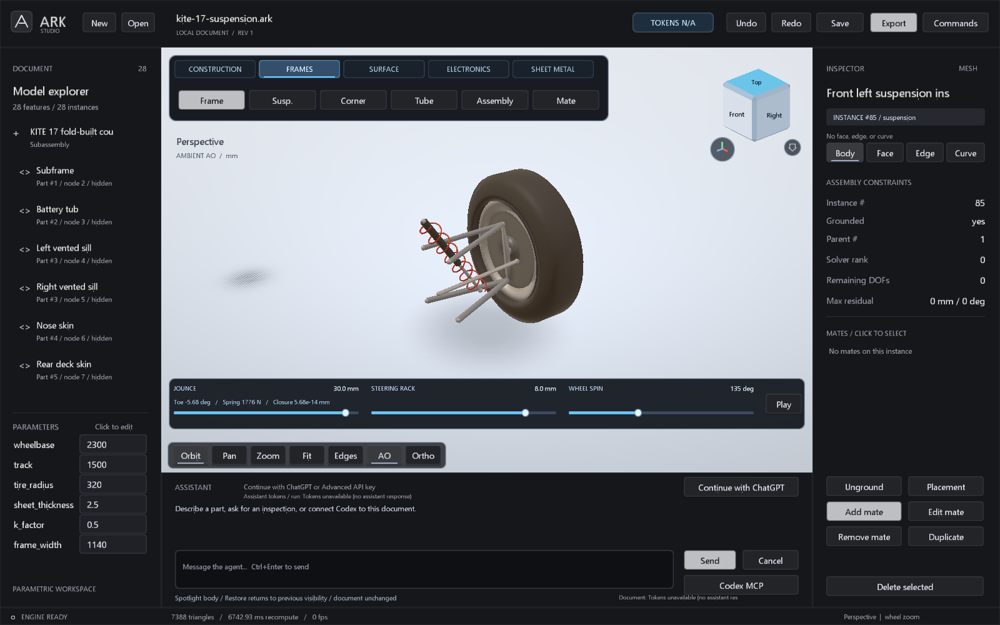

# Selection and context menus

The ribbon includes a Physics workspace for materials, mass/CG, loads and
assembly properties. Icon tiles keep text labels, unavailable-action states
and hover descriptions. The same project-owned icon atlases appear in native
command/context menus. The physical drawer occludes inspector text and hit
targets beneath it; it reports the coordinate frame of its COM/inertia values.
World-coordinate load cases are transformed for selected-part inspections.
See [engineering tools and execution](ENGINEERING_AGENT_V2.md).

Right-click a body in the viewport or its row in Model explorer to open the
same contextual actions: edit its feature, placement, material/appearance,
hide/show, fit, or **Spotlight body**. Empty viewport space offers restore,
show-all, camera views and graphics settings. A context click selects the
clicked occurrence, so actions apply to that part.

**Spotlight** temporarily shows one occurrence and frames it. **Restore previous
visibility** returns to the visibility state before Spotlight. Neither action
edits geometry or increments the document revision. The material dialog edits
the feature's shared material/appearance, so copies of that definition follow
the same change; placement and Spotlight target the occurrence.

Use Body, Face, Edge or Curve in the inspector to select the intended level.
Faces are picked by ray intersection; edges use a screen-distance threshold
and visible-surface occlusion, with adaptive curve tessellation. Escape clears
the sub-selection. Hidden and suppressed bodies cannot capture a pick.
Unfolded/stock and suspension preview meshes do not pretend to expose semantic
exact faces or edges.

Navigation has a dedicated bottom row. Sheet unfolding and suspension playback
use their own row above it. The orientation cube is an overlay in the viewport;
its faces select views, with nearby home/isometric controls.

In the [KITE suspension document](../examples/kite-17-suspension.ark), choose
**Frames > Corner** to show and animate a suspension. Drag Jounce, Steering rack
and Wheel spin independently, or use Play. Right-click > Restore Spotlight
returns to the car. See [the suspension guide](SUSPENSION.md) for the solver's
scope. Choose Sheet Metal to use the original formed/flat/unbend showcase.

