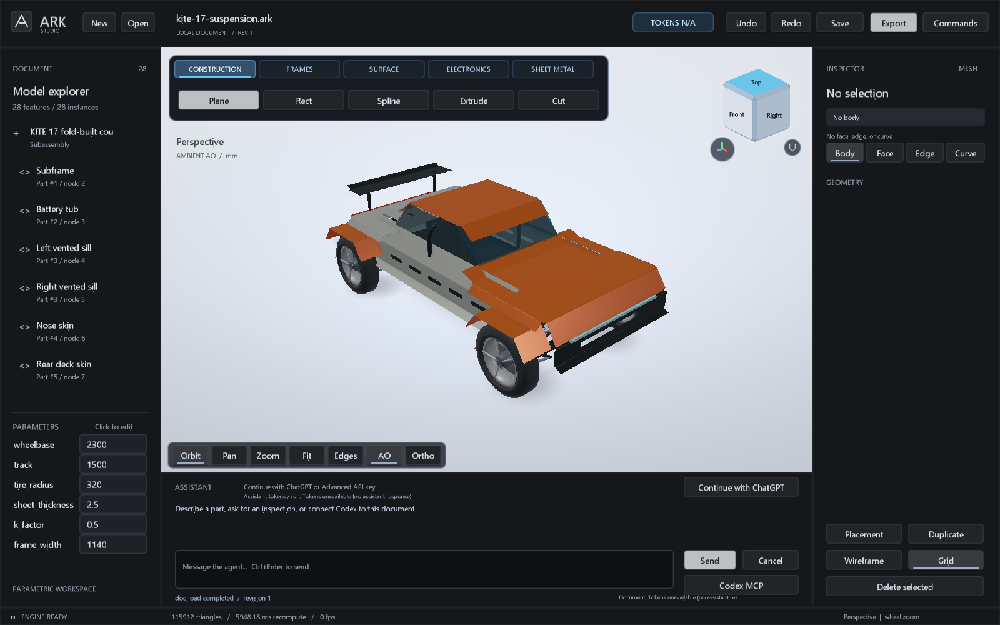

# Double-wishbone suspension preview

Open [the saved KITE showcase](../examples/kite-17-suspension.ark), then choose
**Frames > Corner** to show and animate a suspension. Use the separate Jounce,
Steering rack and Wheel spin sliders, or Play. Right-click > Restore Spotlight
returns to the car. [Studio interaction guide](STUDIO_INTERACTION.md).



ARK stores one suspension corner as a `suspension` feature. Its hardpoints and dimensions are expressions in millimetres, except wheel spin and reported angles, which use degrees. The C++ solver moves rigid upper and lower arms about their fixed inboard hinge axes, keeps the upright length, and closes the tie rod against a translated rack point. The result is a colored, named display mesh and a read-only kinematic report. It is not an OCCT B-rep.

The runnable [single-corner example](../examples/double-wishbone-suspension.arkops) includes a Studio assembly group rotated `rx:-90` so the feature's engineering Z-up coordinates appear Y-up in the viewport. The [KITE vehicle addon](../examples/kite-17-suspension.arkops) places four independent corners and frame mounting cradles in a larger document.

## Authored feature

Create the feature with `doc_apply` and edit it with `feature.edit`. Edits to `native` replace the full authored program, so send all required fields. Named document parameters can appear in any numeric field, including hardpoint coordinates.

```json
{
  "op": "feature.add",
  "type": "suspension",
  "name": "Front left double wishbone",
  "native": {
    "side": "left",
    "hardpoints": {
      "lower_front": [-100, -300, 400],
      "lower_rear": [100, -300, 400],
      "lower_ball": [0, "arm_y", 380],
      "upper_front": [-80, -280, 650],
      "upper_rear": [80, -280, 650],
      "upper_ball": [0, -620, 650],
      "tie_inner": [-60, -250, 520],
      "tie_outer": [-80, -635, 510],
      "wheel_center": [0, -720, 520],
      "wheel_axis": [0, -1, 0],
      "shock_chassis": [0, -230, 800],
      "shock_arm": [0, -500, 400]
    },
    "wheel": {"radius": 300, "width": 180, "hub_radius": 65},
    "spring": {
      "rate_n_per_mm": 40, "free_length_mm": 510, "preload_n": 100,
      "coil_diameter_mm": 70, "turns": 7,
      "min_length_mm": 350, "max_length_mm": 600
    },
    "limits": {
      "jounce_min_mm": -35, "jounce_max_mm": 35,
      "rack_min_mm": -12, "rack_max_mm": 12
    }
  }
}
```

`lower_front` and `lower_rear` establish the lower hinge axis; `upper_front` and `upper_rear` establish the upper one. Their outboard ball joints are `lower_ball` and `upper_ball`. `tie_inner` moves with the rack; `tie_outer` belongs to the upright. The wheel center and axis belong to that same upright. `shock_arm` rotates with the lower arm and `shock_chassis` stays fixed. `wheel_axis` defaults to outward ±Y from `side`; `rack_axis` is an optional top-level xyz direction and defaults to +Y. Mirror all Y hardpoints and the wheel axis for a right corner. Opposite rack displacement signs give mirror-symmetric steering when both corners use the default global rack axis.

The nominal hardpoints define the six fixed link lengths: two upper-arm legs, two lower-arm legs, upright, and tie rod. The upright and tie rod must be at least 20 and 10 mm respectively; each arm leg must be at least 10 mm. The wheel requires radius above 20 mm, width above 5 mm, and hub radius above 3 mm and below 80% of wheel radius. The wheel axis must not approach the upright axis. Coil diameter must exceed 12 mm, turns must lie in [3,20], spring rate and free length must be positive, preload nonnegative, and `min_length_mm < max_length_mm`. The spring endpoints must stay within this declared length interval at every evaluated control state.

The jounce and rack intervals must straddle zero; their widths are limited to 300 and 150 mm. A request outside either interval rejects. The lower and upper arm branches are searched within approximately ±66° of nominal and tie-rod steering within ±57°. A singular or unreachable branch rejects instead of moving the wheel independently of its links. `doc_apply` remains atomic on failure.

## Inspection and motion

`suspension_inspect` solves a requested state without changing the document or revision:

```json
{"id":"Front left double wishbone","jounce_mm":20,"rack_mm":8,"wheel_spin_deg":135}
```

Jounce is the lower outboard ball joint's vertical displacement from nominal. Rack input is a translation in millimetres, not a prescribed wheel angle: the tie rod determines toe. Wheel spin rotates the spokes and marker about the solved wheel axis. The report includes solved hardpoints, wheel center/axis, toe, camber, bump steer relative to the same rack position at zero jounce, upper/lower arm angles, link lengths and maximum closure residual. Studio's sliders and Play control call the same read-only solver. The displayed spring helix changes pitch with solved shock length.

At feature creation, ARK checks nominal and the nine combinations formed by each control's minimum, zero and maximum. For a requested jounce it follows the branch from nominal in increments no larger than 5 mm, re-solving all links at each increment. Each requested state is checked to a maximum rigid-link residual of 1e-5 mm. The authored envelope check samples those nine controls; it is not a continuous certificate for every intermediate pose. Every pose actually requested by the UI or tool is solved and checked separately.

Spring force is reported as `max(0, rate_n_per_mm × (free_length_mm − solved_length_mm) + preload_n)`. It is a declared-rate, quasi-static calculation. Damping, inertia, tyre contact, steering rack compliance, hard stops, linkage interference and vehicle dynamics are not solved. The mesh parts are named and colored for inspection: arms, knuckle bracket/spindle, tie rod, shock body/shaft, coil spring, ball joints, tyre, rim, rotor, hub, spokes and spin marker. Their individual triangle meshes are closed and nondegenerate in the focused tests, but intersections between components are not checked. The mesh remains display geometry; STEP/native-solid tools do not treat it as exact suspension CAD.
