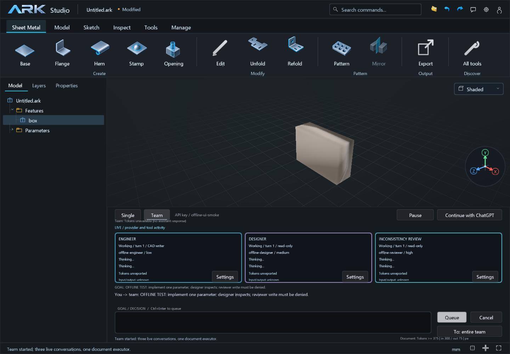
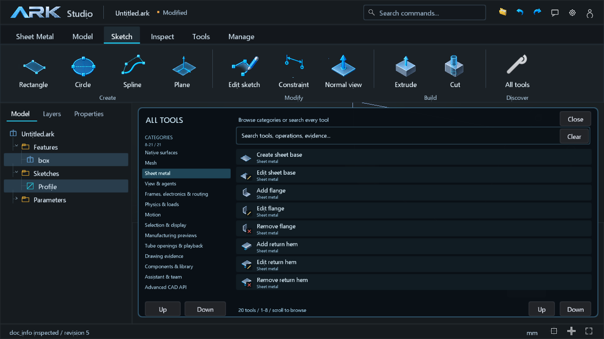

# Team, tooling and component library validation — 2026-10-10

The previous workspace was committed and pushed first as `d73ad18` on `main`.
This update keeps C++/OCCT, adds the team coordinator and manufacturing/library
modules, and vendors the verified SQLite 3.54.0 C amalgamation.

## Local validation

| Check | Result |
| --- | --- |
| Native Release CTest | 44/44 passed, 62.05 seconds |
| Core-only Release CTest | 31/31 passed, 11.02 seconds |
| Studio assistant/team/gallery/library selftest | Exit 0; injected offline providers |
| Visual inspection | Team cards, corrected sketch icons, library form and gallery at 1440 x 1000 and 1280 x 720 |
| Public source integration | Native HTTPS discovery/download, OCCT ingestion, indexed search, insertion/reuse, save/reload and exact STEP export passed |

The final component-onboarding policy was additionally checked with targeted
agent, assistant, team and library-tool tests in both builds. The original open
Studio process was left running; the new binary is in `out/native-release/Release`.
Start it using `start-studio.ps1`. No live paid model call or hosted CI result is
claimed by these local tests. Offline transport tests cover real concurrent
workers, role permissions, stale revisions, steering, pause/cancel, bounded
histories and provider-reported/unknown token accounting.

## Measured local lookup performance

The [benchmark receipt](validation/component-library-100k.json) uses 100,000
synthetic catalog metadata records. Measurements include C++ query preparation,
bound parameters, SQLite execution and returned JSON materialization. They are
35 warm samples after five warmups, excluding network, STEP parsing and MCP.

| Query | p50 | p95 |
| --- | ---: | ---: |
| Exact standard, diameter, pitch and length | 0.0903 ms | 0.1298 ms |
| Broad Portuguese text, `parafuso` | 58.7995 ms | 59.8247 ms |
| Text plus exact part number/dimensions | 3.8979 ms | 4.0576 ms |

The exact query uses the covering `components_dimensions_ordered` index.
Adding stable ID order to the dimensional index reduced the measured p95 from
5.9823 ms to 0.1298 ms on this fixture without changing result ordering or
matching rules. These are workload-specific measurements, not a claim to be
faster than every database. A separate one-real-record MCP lookup, including
JSON/stdio transport, measured p50 0.1669 ms and p95 0.2292 ms over 30 warm samples.

## Real source custody and reuse

The public integration used KiCad's
[`PinHeader_1x02_P2.54mm_Vertical.step`](https://gitlab.com/kicad/libraries/kicad-packages3D/-/blob/master/Connector_PinHeader_2.54mm.3dshapes/PinHeader_1x02_P2.54mm_Vertical.step).
The source byte SHA-256 is
`ea4d0799007ebdd3945072bf255d673d2fe87eb05fda85fd8d7993ad9397da41`.
The explicit complete-source selection has one native solid and 52 faces;
its topology census is measured from the source, not inferred from the name.

Two inserted instances reused one definition. Save/reload retained the source
package. Exact STEP readback reported volume 39.382218773333506 mm3, symmetric
volume difference 0, bounds difference 0 and area difference approximately
1.42e-14 mm2. One real example was added to the default local library under
`%LOCALAPPDATA%/ARK/components`; no synthetic benchmark records were added there.
The source page, actual download URL and
[KiCad license](https://www.kicad.org/libraries/license/) are retained in metadata.

The public source adapter currently discovers KiCad by directory/page. Direct
public HTTPS STEP URLs and local files use the same native ingestion path.
TraceParts and 3Dfindit are documented provider integrations requiring their
own access; account-based acquisition was not implemented or exercised.

## Boundaries

Manufacturing inspection separates exact geometry from declared process inputs
and unresolved checks for injection molding, FDM and machining. It does not
certify strength, molding feasibility, toolpaths, actual filament savings or a
supplier standard. Source component geometry is immutable; it does not recover
the supplier's feature history. Portable component documents use version 24
and retain the existing 4 MiB document limit.

The icon update used built-in ImageGen. The retained project asset is
`assets/ui/ark-detail-atlas-v1.png`; its exact prompt is in
[`design/ark-detail-atlas.prompt.txt`](design/ark-detail-atlas.prompt.txt).
Code glyphs add distinct library and edit/remove affordances.
