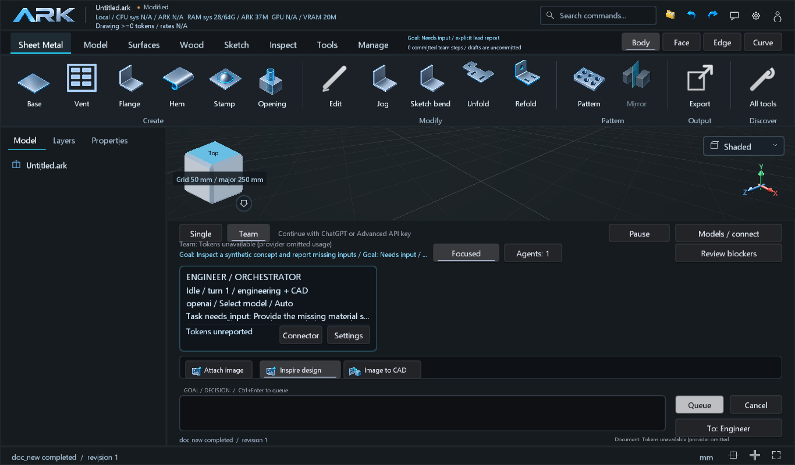
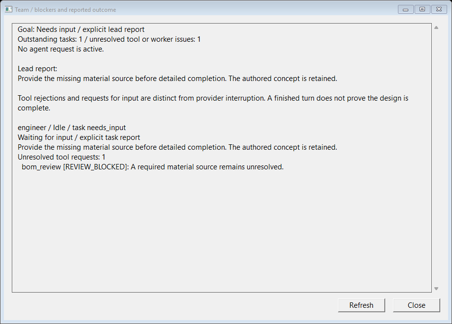

# 030D team outcomes and blocker inspection

This addresses **A.03/D.02/D.04 — Parcial** within the unpublished 030D
development iteration. It changes status reporting and diagnostic inspection;
document formats, geometry authority and completion gates are unchanged.

## Reproduced failure

A completed provider turn could explicitly report `needs_input` after a rejected
tool request. The team snapshot then replaced that accepted report with
`Interrupted / completion not reported` merely because an unresolved tool error
remained. Every normally finished role also received a generic status claiming
that a task report was still needed, even after reporting its task.

The synthetic regression returns a blocked detailed review, reports the task and
goal as `needs_input`, and finishes the provider turn normally. Before the fix,
the assertion retaining that explicit input report failed. It uses no customer
design, live model request or supplier website.

## Resulting behavior

- Explicit `needs_input` survives retained tool rejections, with its lead summary
  and unresolved-error count. A normal provider finish displays the task's actual
  report state. It still does not certify design completion.
- Actual cancellation, worker/transport interruption, failure and an explicitly
  configured continuation boundary retain interrupted status. Unresolved errors
  still prevent completed-goal acceptance; they are never silently dismissed.
- **Review blockers** is available for an inactive team or unresolved errors.
  Its modeless, read-only, scrollable window shows the declared outcome, task
  summaries, actual tool names/error codes/messages and worker errors. Refresh
  takes a new snapshot without resuming a provider or issuing CAD tools.
- Normal viewport polling copies blocker counts only. Up to eight compact tool
  diagnostics per role are copied only on explicit inspection; provider histories
  and geometric buffers are excluded. Truncation is stated with the full count.

Tool errors remain requests to inspect and correct their cause. Rejected writes
retain atomicity and `expected_revision`. Reading diagnostics neither repairs a
rejected design operation nor qualifies a design for manufacture. Missing source
information can require an explicit user decision; a UI fix does not provide it.

## Verification scope

The agent-team regression covers the accepted input report, retained actual error
details, light polling without copied histories/diagnostics, and cancellation
after a prior input report. Existing completion tests still require a corrected
successful tool receipt before a completed goal can be accepted.

`studio-team-blockers-ui` exercises the actual Review blockers action, an
editable-session ownership check, the read-only report, Refresh, resize and
native captures. Synthetic usage bookkeeping is distinguished from CAD edits.
The native busy-message pump also serves this read-only inspector. Closing it
while a model operation runs closes only the inspector, without requesting
Studio shutdown or consuming a provider request.
The [receipt](verification-030D-team-outcomes.json) freezes runtime source at
`41e5b6a3d833c474c17e4725425052aba45f8927`. The full Windows native/Studio
Release suite passed **156/156 in 274.58 seconds**; the focused portable-core
agent-team test passed **1/1**. The native standalone agent suite reports
**356 checks**. Source, executable and inspected-image hashes remained unchanged
after the full suite. Hosted CI for this source is separate from the four
successful jobs on the preceding `df615d7` source.
No interrupted user session is restarted or replayed by this change.

