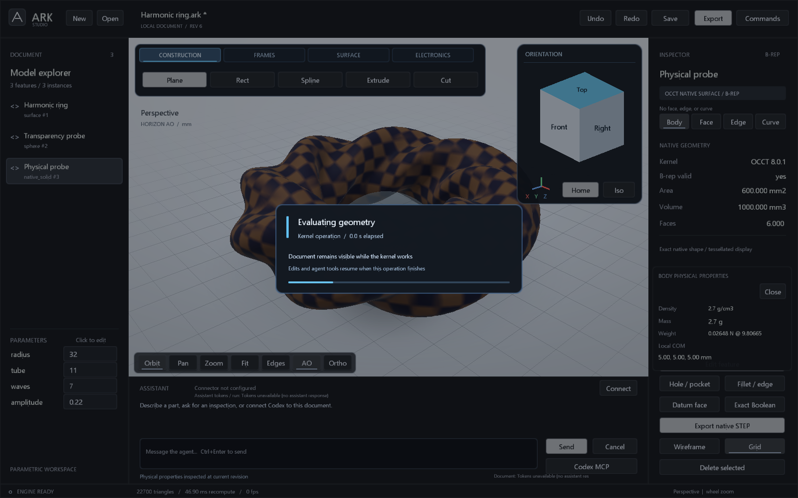

# Validation record

## 2026-10-08: contextual editing, browser login and suspension

The default installed native build passed **35/35** CTest cases; the core-only
build passed **23/23**. Installed Studio self-tests for context actions,
suspension motion, sheet showcase, native modeling, sketch and assistant each
exited 0. Rendering and engineering UI tests also passed in the staging build.
Context layout checks passed at 1180x850, 1600x1000 and 2923x1100; navigation and
playback occupy separate rows. Right-click actions cover viewport and tree,
Spotlight restores previous visibility without changing geometry revision, and
hidden bodies cannot capture selection.

Native edge display/picking now uses deflection-driven tessellation. Regressions
check a large circular edge's chord error and an inflected bridge curve's two
lobes, endpoints and length. Quarter-point refinement prevents a midpoint-on-chord
S curve from collapsing to a line. These display samples do not certify exact
geometry; the OCCT B-rep remains authoritative.

The [KITE suspension showcase](../examples/kite-17-suspension.ark) contains four
double-wishbone corners and 24 frame mounting members. At jounce 30 mm, rack
8 mm and wheel spin 135 degrees all four solve with link residuals below
1e-5 mm. Focused tests cover mirrored corners, expression edits, invalid/unreachable
poses, atomic rollback, persistence and closed nondegenerate display parts at
nine sample poses. This is kinematics and an ideal spring-force calculation,
not dynamics, collision, fatigue, strength or fabrication qualification.

Native ChatGPT sign-in tests cover OAuth state/PKCE, runtime-generated RSA/JWKS
ID-token validation, scope/plan errors, account/model parsing and temporary DPAPI
storage without reading the user's profile. The explicit safe status diagnostic
reported `connected=false`, `plan_authorized=false`, `account_count=0` at the
last live check. Browser launch is implemented; real account consent and paid
inference are not claimed as validated. See [assistant setup](ASSISTANT.md).

Build/test logs, saved pre-upgrade Studio documents and pose reports are under
`out/suspension-upgrade/`. Showcase screenshots are committed in `docs/`.

## 2026-10-07: KITE sheet-metal showcase and drawing usage

Native CTest passed **33/33**; core-only passed **21/21**. Studio self-tests for
sheet showcase, rendering/loading, engineering dialogs, sketches, native
modeling and the assistant each exited 0, as did the live MCP integration.
The new sheet UI test exercises exact slot/window creation, repeated openings,
flat DXF export, global formed/flat switching, stock preview and unchanged
geometry revision. Preview meshes refuse semantic face/edge selection.

The [KITE 17 coupe](../examples/kite-17-showcase.ark) has 23 definitions and
79 placed parts, including 9 sheet definitions (24 unique authored bends),
15 placed sheet parts and a 12-member tube subframe. All 9 sheet definitions
exported analytic flat DXF and exact flat STEP successfully. At the declared
K=0.5 each reports geometric material conservation and independent refold
evidence. The slot/window/pattern tests also reject stale flat digests and
overlapping openings; no sampled contour fallback is used.

The drawing token ledger tests cover persistence, exact receipt retry
deduplication, monotone snapshots, invalid data, capacity rejection, geometry
undo/redo preservation and client-supplied provenance. Studio additionally
tests that usage arriving during a kernel operation is deferred until the
worker joins, and that a receipt carried into an assistant-owned document
load leaves metadata dirty until saved. This external MCP-authored showcase
has no reported provider usage, so its token badge is N/A.

Evidence and per-part DXF/STEP files are under `out/kite-showcase/`. The
orientation gizmo, formed car, orthographic blank layout and straight-stock
views were inspected from native OpenGL captures. These are geometric/showcase
checks, not crashworthiness, forming-trajectory or fabrication qualification.

## 2026-10-07: engineering workspace and exchange

The next local extension adds version-16 modules and 38 MCP tools. Native
MSVC/OCCT CTest passed **30/30**; the separate core-only build passed **19/19**.
The actual Studio engineering-dialog, render/loading, sketch, native and
assistant UI self-tests each exited 0. Live Studio/MCP edit, mesh, persistence,
undo, New and disconnect integration also passed.

The integrated [vehicle example](../examples/vehicle-engineering.ark) evaluated
18 frame members, two lofted/thickened body panels, a controller PCB and a routed
cable. Frame tests cover round/rectangular bent members, exact cope trimming,
named semantic datums, save/load, rollback, density changes and world-space
assembly COM. Electronics tests cover DRC failures/connectivity, fabrication
preview syntax, exact cable sweep/obstacle checks and transaction rollback.

OBJ and ASCII FBX were read independently by a pinned ufbx build: 47,574
vertices, 78,534 triangles and normals. FBX unit scale was 0.001 metres. IGES
was independently read by OCCT with bounds/area checks; STL/STEP regressions
remain covered. This does not establish appearance, hierarchy or parametric
history preservation in triangle exports.

Three isolated recomputations of the same vehicle yielded median **1788.28 ms**
with `ARK_NATIVE_THREADS=1`, and **1295.96 ms** with eight threads (about 1.38x).
Frame volume (7,449,220.792 mm3) and mass (58,476.423 g) were unchanged in all
six runs. This is one measured workload, not a universal speedup claim.
The RTX 4080 SUPER CUDA transform test also executed with zero output error;
complete transfer-inclusive timings favored CPU in the recorded 2M-vertex run,
so the adaptive policy selected CPU. GPU display rendering remains active.

Screenshots at [1600 px](vehicle-engineering-studio.png) and a separate 1180 px
capture were inspected. The loading self-test checks that paint/resize and
queued tool messages are pumped while one worker has exclusive session access;
queued tools execute after the operation, without concurrent document mutation.



Evidence is in `out/engineering-upgrade/` (local, ignored): CTest logs, UI
captures, native/GPU measurements, module reports and exported files.
`open-document-before-upgrade.ark` preserves the user's previously open
revision-2 airplane document. The runtime code, modeling modules and export
implementations are C++; PowerShell orchestrated local validation only.

## 2026-10-07: materials, renderer, physics and agent geometry

MSVC Release / OCCT 8.0.1, based on `main` at
`a933eb0cffe9190b3cf5c1d653247e7303cd7c35` plus this working-tree change.

| Check | Result |
| --- | --- |
| Default `scripts/build.ps1 -Test` | 27/27 CTest suites passed |
| Separate `ARK_WITH_OCCT=OFF` build | 17/17 suites passed |
| Native render UI self-test | Exit 0; texture, roughness, four distinct AO modes, transparency and physical-properties card |
| Native sketch, native modeling and assistant UI tests | Each exit 0 |
| Live Studio + MCP integration | Passed edit, mesh, save, undo, New and disconnect checks |
| Material persistence and atomicity | Version 15 round trip, legacy loading, invalid values, missing references and rollback passed |
| Appearance-only edits | Preserve the exact B-rep cache; `geometry_recomputed:false` |
| Physical quantities | Exact volume/density, explicit gravity, world COM with rotated parts and pattern copies passed |
| Agent geometry | Plane-split side/volume/reference tests and copy-only mirror tests passed |
| Assistant usage | Multi-round totals, cached/reasoning subsets, partial/missing/malformed and incomplete-response cases passed using offline transport |

The assistant UI also verifies that creating a new document during a modeling
request retains the current run's usage: three injected responses total exactly
375 tokens in the document counter. This check was rerun after the final UI fix.

The actual OpenGL AURORA capture is
[aurora-plane-studio.png](aurora-plane-studio.png). The render test compares
geometry-region pixels, excluding UI labels, and checks that Off, Contact,
Ambient and Horizon modes differ. It also checks an exact 10 mm cube at
2.7 g/cm3: 2.7 g, local COM (5,5,5) mm and weight at 9.80665 m/s2.
Native CAD geometry remains independent of display appearance. No paid LLM
request, aerodynamic analysis, structural simulation or Fusion parity test was
performed.

Local build/test logs and UI captures are in `out/studio-upgrade/`; that folder
is not versioned. The default executables were rebuilt in
`out/native-release/Release`. The previously open document was preserved as
`out/studio-upgrade/pre-upgrade-live.ark` before restarting Studio.

Reproduce the rendering check after building:

```powershell
.\out\native-release\Release\ark-studio.exe --self-test-render-ui --shot out/render-check.png
```

Local validation on 2026-09-22, Windows, GNU C++ 16.1.0 / MinGW-w64, CMake Release build.

| Check | Result |
| --- | --- |
| Clean CMake compile of kernel, CLI, MCP, Studio and tests | Passed |
| Existing kernel regression suite | Passed |
| New agent/math/mesh regression suite | 196 checks, zero failures |
| Real MCP stdio integration | Passed: initialize, discovery, notification handling, malformed JSON, revision conflict, atomic edit, save/load, STL and PNG |
| CTest | 3/3 suites passed; approximately 0.45 s on the local machine |
| Native Studio UI dispatch smoke | Create, undo, redo, delete, wireframe, grid and camera actions passed |
| GPU rendering | Actual executable captured at 1600x1000 and 1180x840; OpenGL error check passed |
| Native replay | Harmonic `.ark` loaded, `.arkops` replay changed waves/amplitude and rendered the revised mesh |
| Agent visual feedback | Software-generated PNG inspected after correcting perspective division |
| Harmonic sample | 10240 vertices, 20480 triangles, one indexed connected component, zero boundary/nonmanifold edges and zero degenerate triangles |

The screenshot in [README](../README.md) comes from the actual native application, not a design mockup. Headless frames show zero FPS because they do not run the interactive timing loop. Recompute milliseconds shown in screenshots are a single local sample, not a benchmark guarantee.

UI checks exercise the application's action dispatch, not a full mouse/keyboard automation suite. Common file dialogs and the modal text editor have not been exhaustively automated. The topology report does not test self-intersection, vertex manifoldness or certified solid validity. These tests are initial regression evidence, not CAD production acceptance.

Reproduce:

```powershell
.\scripts\build.ps1 -Test
.\out\build\ark-studio.exe --self-test-ui --shot out/studio.png --size 1600 1000
.\out\build\ark-studio.exe --load examples/harmonic-ring.ark --script examples/refine.arkops --shot out/refined.png --size 1180 840
```

On Windows the GUI executable may return control to PowerShell before it exits; use `Start-Process -PassThru` and wait on that process when scripting. The GitHub Actions workflow builds and tests Windows/MSVC and Linux/GCC; consult the repository's workflow run for current CI status.

## GitHub Actions availability

The first [workflow run](https://github.com/CenturyMesh/Ark/actions/runs/35763704970) did not start a runner. GitHub reported failed account payments or a spending limit requiring an increase. The Windows job has no executed steps; Linux was canceled by the matrix after that infrastructure failure. Windows/MSVC and Linux/GCC have therefore not been validated by CI. Local MinGW tests and native rendering above passed independently. No billing settings were changed.

## Version 0.3

The record above describes the initial 0.2 baseline. For current assembly/tube/CUDA test evidence and timing, see [MECHANICAL.md](MECHANICAL.md). The launcher and build script now default to `out/next`, keeping the running 0.2 binary intact during this upgrade.

## Version 0.4

The integrated build defaults to `out/fabrication`. New C++ notch tests check analytical cut-face closure and its inverse, independent volume integration, side orientations and invalid envelopes. Optional OCCT integration tests validate four retained-wall sides, STEP readback, B-rep validity, retained material and rejection of modified cutters. See [NOTCH_WORKFLOW.md](NOTCH_WORKFLOW.md) for the explicit geometric/physical boundary.

The neutral UI was built and visually checked at 1600x1000 and 1180x840. Native in-app fixtures exercise property, placement and command dialogs plus acceptance/cancellation, creation and undo. The UI and assembly smoke modes returned zero exit codes. External click automation was unavailable because the native computer-use pipe could not connect; these checks do not claim an exhaustive external interaction test.

## Version 0.5

The integrated build defaults to `out/bend`. Six native/stdio CTest suites pass. Additional native workspace/export fixtures and a real Windows STEP worker test cover the complete editable-tube workflow, export from the folded pose, Unicode output paths and backend failure. See [BEND_WORKSPACE.md](BEND_WORKSPACE.md) for scope and reproduction details.

## Version 0.6

The integrated build defaults to `out/source`. Seven CTest suites pass. Optional OCCT tests cover an independently constructed synthetic source, rigid-transform metamorphism, rejection of a hole on a deforming hinge, source import/save/load/export, source drift and read-only geometry. Native source workspace tests verify formed/straight rendering, opening focus, unchanged source data during animation and export. The real source is verified locally; its CAD and derived assets are excluded from Git. Details are in [SOURCE_STEP.md](SOURCE_STEP.md).


## Version 0.7 (2026-09-23)

The integrated launcher/build now defaults to `out/sketch`, leaving the existing
0.6 executable intact. Native MinGW C++20 release build succeeds. **12/12 CTest
suites pass** (approximately 1.8 seconds locally): kernel, agent, MCP stdio,
mechanical, notch math, bend workspace, source tube, parametric sketch, live
session, assistant connector, CSG budget and prismatic cut.

New independent checks cover interpolation error against Barry-Goldman,
parameter-preserved hole distances and actual through-hole rays, tilted planes,
cap area and volume, repeated/rotated cuts, concave triangulation, periodic angle
dimensions, precision-collapse rejection, atomic failures and native persistence.
The source-specific 80-check run still passes on the user's local tube. Its
embedded source package is unchanged after adding a datum/sketch and saving then
reloading as version 5; the private CAD remains excluded from Git.

The final `out/sketch` executable passes native UI, sketch workflow, offline
assistant and source-tube UI smoke modes. Screenshots at 1600x1000 and 1180x840
were visually reviewed, including curve anchors, real openings, hard-surface
shading, graphics checkboxes and absence of the old ribbon. Assembly and bend UI
regressions also passed during UI integration. These are native dispatch/dialog
fixtures, not an exhaustive external mouse-automation test.

`tests/studio_live_integration.py` passed against the final Studio/MCP binaries.
Separate proxy processes onboarded to the open document, changed a dimension,
verified moved holes and closed topology, saved version 5, undid the edit,
created/undid a new document, and received an explicit error after Studio exited.
Only the test's own temporary process and files were controlled.

The Responses connector passes offline protocol tests and actual WinHTTP
loopback tests for success, rejected redirects, HTTP errors, malformed JSON,
timeout and cancellation. The in-app fixture additionally proves an assistant
can create a new document then model within one turn, and that intervening
operator edits reject stale work. No paid/live provider request was made;
provider credentials/model access are not verified by these local tests.

General mesh CSG retains its known geometry limitations. The new prismatic
through-cut path requires independent sampled cap-area, volume and closed-mesh
checks. General sketch cuts and extrusions reject failed topology or nonpositive
volume before commit. This does not establish an exact B-rep CAD kernel or
physical manufacturing qualification. [Detailed sketch evidence](PARAMETRIC_SKETCH.md).

## Version 0.8 (2026-09-23)

The final build is `out/native-release/Release`, using MSVC C++20 and the
verified OCCT 8.0.1 SDK. The existing Studio process was left intact while this
separate output directory was built. The launcher, build script and VS Code
CMake preset now select the new output directory.

**17/17 headless CTest cases passed** in the final native build (5.48 seconds
on this machine). These include the previous core regressions and C++ tests
for source tube/notches, native surfaces, authored sheets, imported source
sheets, and native feature history/STEP persistence. The optional portable
core configuration also passed 12/12 tests locally on Windows; this is not a
claim of a hosted Linux native OCCT run.

The real SKT01 source was imported, saved to a new native `.ark`, and exported
through the final MCP/native worker. Process exit was zero. Runtime
`kernel_info` returned OCCT 8.0.1, C++, and `python_required:false`. The result
retained 31 outer-wall openings (23 circular, 8 polygonal), two original solids
including the small attached solid, and flat length 1128.1609031525 mm.
Independent refold and STEP readback symmetric-difference volumes were both
zero. The 80-check source preview test also passed on that newly saved project.
Private input CAD and generated source artifacts remain outside Git.

The native sheet tests verify uniform-panel recognition, opposed bend skins,
complete contact, circle/polygon openings, inverse mappings, a rotated source,
explicit selection among multiple bodies, an independently built flat sheet,
non-midwall K accounting, source/refold material agreement, tampered payloads,
changed source rejection and rejection of a hole crossing the deforming bend.
Surfacing tests cover an analytic frustum, open loft, nonplanar fill, a NURBS
plane, thickening, STEP readback, invalid input and atomic history rejection.

The final executable passed native UI smoke (sheet create, actual Formed/Flat
geometry change without revision change, STEP export, sheet reimport, NURBS
editing) and the existing source-tube UI smoke. Loft, curved surface and sheet
examples were rendered and visually checked. The C++ live Studio/MCP test
passed edit, hole movement, mesh inspection, save, undo, New and explicit
failure after disconnect. These UI checks are separate from the headless
CTest gate; hosted OpenGL availability is not assumed.

All tracked `.py` bridge, audit, benchmark and test programs, and the OCP
requirements file, were removed after their native replacements passed.
The two old local bytecode files were removed separately. No Python process
was used during this migration. Dependency caches under ignored `out/deps`
contain the unmodified upstream SDK source; its optional developer tools are
not ARK runtime or test dependencies.

The implementation and supported-domain limits are documented in
[SHEET_METAL.md](SHEET_METAL.md), [SURFACING.md](SURFACING.md), and the read-only
[Stage donor assessment](STAGE_NATIVE_ASSESSMENT.md). Native B-rep validity and
round-trip checks do not certify physical manufacturing. Legacy mesh features
remain distinct from native exact-shape features.
