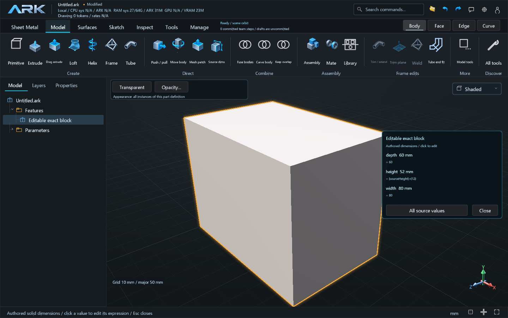
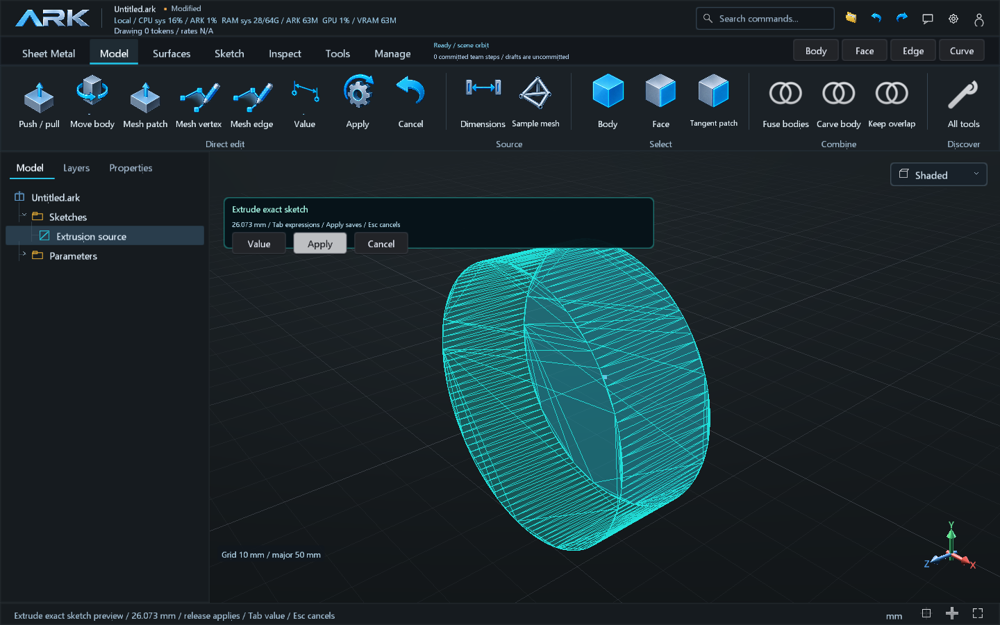
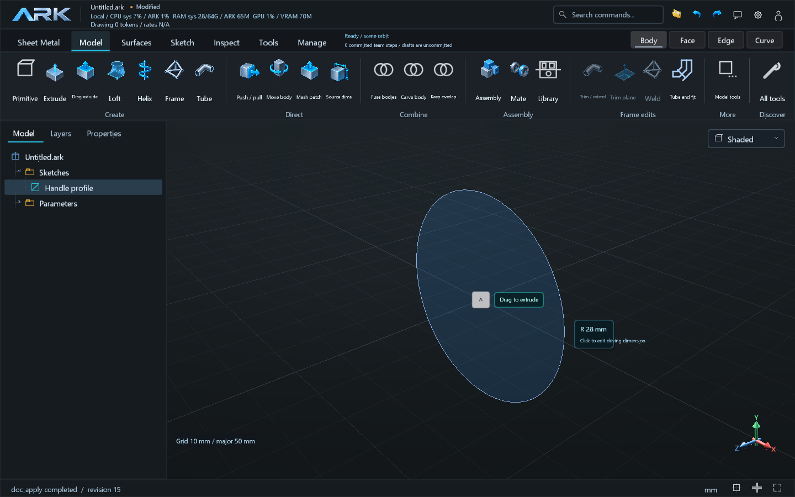
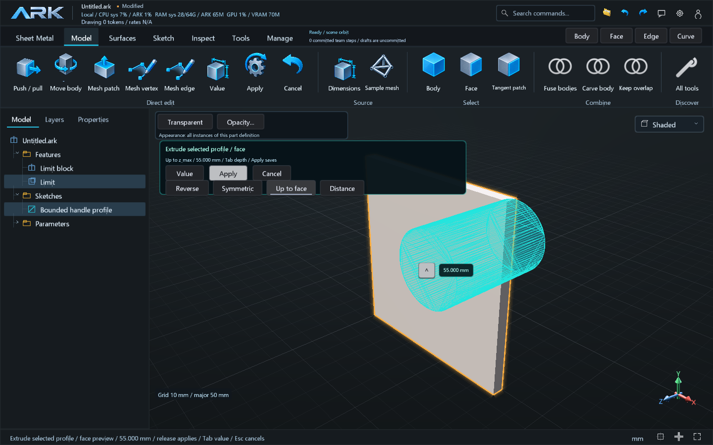

# Exact extrusion gestures and authored solid dimensions

This extends the local authoring scope of **B.01**, **B.02** and **B.03**. These
milestones remain **Parcial**; the complete navigation and feature-history acceptance criteria
remain in the roadmap.

## Extrude a closed sketch by dragging

Select a saved closed sketch or one exact planar face. A cyan **Drag to extrude**
handle appears on that source; drag it along the normal to preview the extrusion.
**Model > Drag extrude** (also available under Sketch > Build) uses the selected
source directly, and asks for a saved sketch when no source is selected. The exact
native extrusion is evaluated in an isolated candidate. Releasing saves a valid
candidate as a `native_solid` extrusion. The profile and sketch plane remain its
source. **Tab** accepts a depth expression; **Apply** saves it, and **Esc** cancels.
Selecting a planar B-rep face retains the exact face and its inner wires as the
source of a separate extrusion feature. Its source and limit bodies remain
physical outputs in the viewport, BOM and aggregate mass; the dependency does
not consume or fuse them. It does not reconstruct a sketch from
the display mesh. Placed faces require editing their part definition.
At compact window widths, the Model ribbon keeps the main Create, Direct and
Combine actions readable; **Model tools** retains the assembly, frame and other
advanced commands.
**Reverse** changes the normal direction; dragging across the source plane also
chooses the opposite direction. **Symmetric** treats the entered depth as the
total span and places half on each side of the original source plane. Numeric
depth remains a positive authored expression. Zero, negative depth, open or
otherwise invalid profiles reject with the source retained.

**Up to face** asks for a face in the viewport and derives the depth from its
exact B-rep. The selected face must be planar, parallel to the source, ahead in
the chosen direction, and cover the complete end cap. Coverage is checked by an
exact face Boolean, including holes; matching plane positions or mesh bounds
alone are insufficient. The source face's feature ID and semantic reference are
persisted and recomputed when that source changes. **Apply** saves this candidate.
**Distance** returns to an entered depth. Up to face and Symmetric are mutually
exclusive. Curved or tilted limits, incomplete cap coverage, placed limits,
missing, split, deleted or stale references reject explicitly. These cases do
not fall back to an unbounded plane or a mesh-derived depth.

For an existing exact sketch extrusion, choose **Push / pull** and drag its
`cap.end` face. The gesture changes the authored depth expression while preserving
the starting cap and source profile. **Tab** enters a signed increment expression.
This operation supports the original extrusion feature, including a named datum
plane and a source planar face. A symmetric end-cap gesture changes total depth
by twice its displacement. An associative face limit is edited through its
source history. Downstream Boolean or transformed solids must be edited through their
source history. Placed occurrences require editing their part definition.

## Exact extrusion source contract

`native_solid` with `op:"extrude"` retains the existing positive `p.depth`
expression. `p.direction` is `1` or `-1`; `p.symmetric` is `0` or `1`. A saved
sketch uses `p.sketch`. An exact planar face uses `native.source_face` and its
feature as the first `inputs` entry. Up to face uses `native.mode:"up_to_face"`
and `native.limit_face`; its feature is the first input for a sketch, or the
second input for a source face. Only these ordered dependencies are accepted.
The report includes `extrusion.depth_mm`, `direction`, `symmetric`,
`start_offset_mm`, source kind and `limit_cap_coverage_checked`.

```json
{
  "expected_revision": 12,
  "commands": [{
    "op": "feature.add", "type": "native_solid", "name": "Face-bounded extrusion",
    "inputs": [7],
    "native": {"op": "extrude", "mode": "up_to_face", "limit_face": "z_min"},
    "p": {"sketch": "Profile", "depth": "20", "direction": "1", "symmetric": "0"}
  }]
}
```

Use current IDs and face names from `reference_inspect`. In face-limit mode the
retained distance expression is inactive; the current exact limit determines
depth. Preview, persistence and commit retain the same geometry authority and
revision contract. The extended extrusion program saves as document version **36**, so an older
runtime rejects it instead of silently evaluating a forward, one-sided extrusion.
Legacy forward extrusions without these fields retain their previous document
version. The version changes for the new geometry semantics only.

## Double-click a solid

Double-click the visible solid in Body mode to expose its authored dimensions.
Each row shows the evaluated value in the selected display units and its stored
expression. Click a row to edit that expression. Named parameter bindings remain
editable; the row displays source parameters, rather than inferred tessellation
bounds. Geometry validation and publication are atomic.

**All source values** opens the full source editor. **Edit driving sketch** opens
the profile where its line, radius, arc or rectangle dimensions can be changed.
A feature without supported scalar dimensions offers **Edit feature**. The
viewport shows as many rows as fit; the full editor keeps the remaining values
available. **Esc** or **Close** dismisses the overlay. Editing a placed occurrence
changes its shared part definition and consequently every occurrence.

## Agent dimensions use the same source

Inspect `doc_info{detail:"design"}` to obtain the current revision, feature IDs
and parameters. To add a named depth and bind an existing extrusion, apply both
commands in one transaction at that observed revision:

```json
{
  "expected_revision": 12,
  "commands": [
    {"op": "param.set", "name": "depth_mm", "expr": "25"},
    {"op": "feature.edit", "id": 7, "p": {"depth": "depth_mm"}}
  ]
}
```

The sketch onboarding also returns `dimension_create_example` and
`dimension_edit_example` with the live observed `expected_revision`. For example,
a new driving radius can be authored as one parameter and one linked sketch:

```json
{
  "expected_revision": 12,
  "commands": [
    {"op": "param.set", "name": "profile_radius_mm", "expr": "7"},
    {"op": "sketch.set", "name": "Dimensioned circle", "sketch": {
      "plane": "XY",
      "entities": [{"kind": "circle", "name": "ring", "dof": [0, 0, "profile_radius_mm"]}],
      "constraints": []
    }}
  ]
}
```

Refresh the revision before altering that radius with
`doc_apply{expected_revision:13,commands:[{op:"param.set",name:"profile_radius_mm",expr:"9"}]}`.
The example creates a new sketch; retain the existing profile's full entity and
constraint source when editing a saved sketch. Numeric solver variables can
instead use a radius constraint such as `{type:"radius",a:0,val:"profile_radius_mm"}`.

An agent can subsequently change `depth_mm` with `param.set`, or edit a feature
parameter with `feature.edit`. Use actual IDs and revision from the inspection.
For profile dimensions, edit the authored sketch or its named driving parameter;
the solid follows the source on recomputation. Stale revisions and invalid
geometry reject without silent rebase or partial publication.

## Verification scope

The dedicated `direct-dimensions` test measures exact native extrusion volume on
an XZ source plane, a retained cap displacement expression, subsequent agent
radius/depth changes, negative and stale write rejection, and persistence.
`studio-direct-authoring-ui` exercises the rendered tool, drag preview and release,
Tab expression entry, exact cap editing, viewport double-click, clickable source
rows, invalid edits and a stale displayed-row receipt. It also retains the
existing primitive and indexed mesh gesture checks.

`extrusion-bounds` adds measured reverse and symmetric caps/volume, face sources
with holes, associative planar limits, target movement, full-cap coverage,
ordered source dependencies, persistence and atomic rejection. The Studio test
also operates the on-source handle, depth input, Reverse, Symmetric and Up to
face controls, captures their previews and saves the same source recipes.

These are local geometry and Studio checks. They do not qualify fabrication,
external integrations, distribution or every feature type.

Local check details: [verification receipt](verification-direct-dimensions.json).
Extrusion bounds details: [verification receipt](verification-extrusion-bounds.json).








