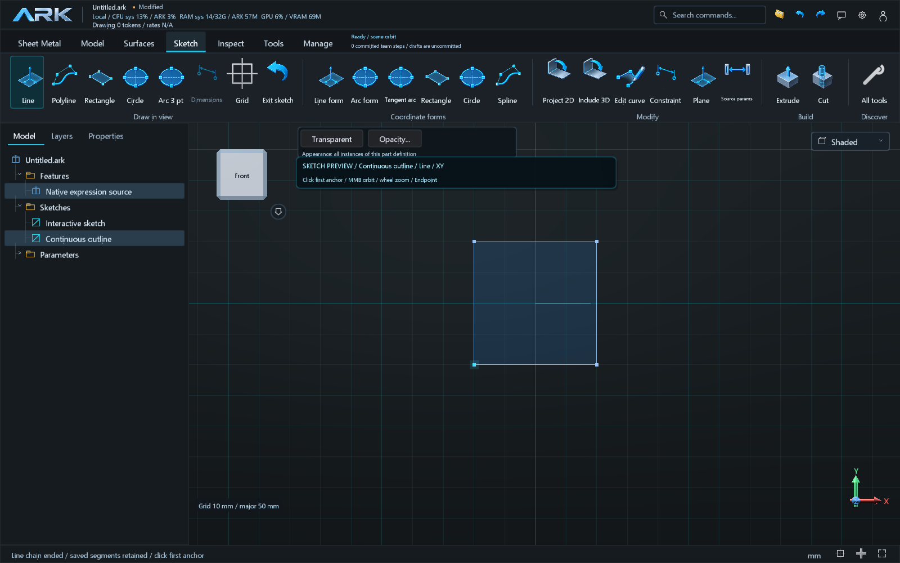
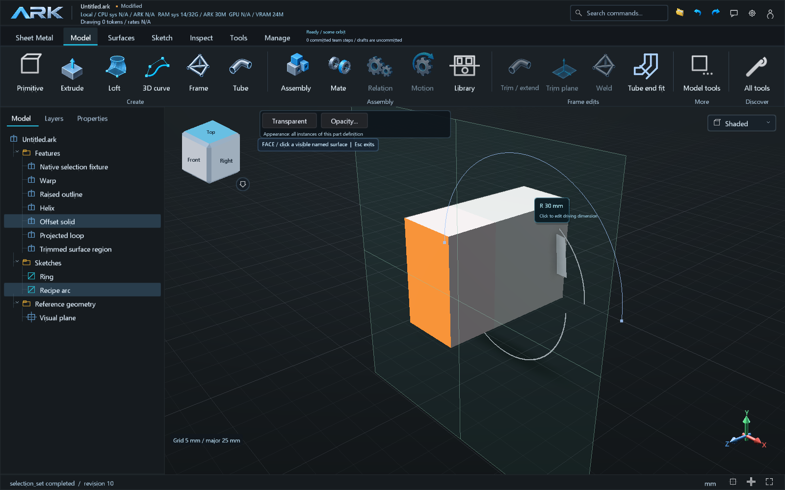
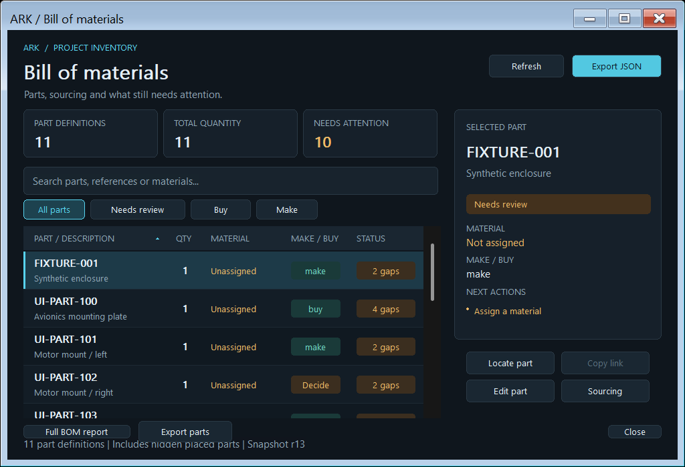

# 017B — continuous sketches, surface authoring and BOM export

Runtime `0.9.18`, baseline `36f0796`, milestones A.01/B.01/B.02/B.03/B.05/
D.02/D.04/E.01. This branch remains a draft awaiting human testing.

Ordinary Line retains its last endpoint for the next segment. Enter ends the
chain and Escape exits drawing; committed points and existing pixel snaps are
retained. Closed regions shade in the viewport, including nested holes;
construction curves, open chains and invalid loops are excluded. Shading is
display evidence. Native validation still owns production geometry.

Saved line/circle/arc dimensions accept parameter expressions. Rectangles
retain their existing width/height editor and constraint diagnostics. Spatial
line segments have a driving `length`; circular arcs have an expression-driven
radius, and coordinates/NURBS poles remain editable expressions. This extends
dimension authoring; it does not add a general 3D constraint solver.

XYZ equation curves interpolate 2–512 samples using an exact B-spline through
those samples. Deviation from the analytical equation between samples is not
bounded. Directional wire projection onto surfaces and closed-wire trim retain
linked inputs. Trim requires one open face and an interior keep point on that
surface; ambiguous, outside and boundary points reject atomically. Projection
requires one connected result. Planar and nonplanar tests cover both operations.

Sketch offsets preserve analytic circles/arcs and linked distance expressions.
Other sketch offsets retain sampled miter segments and reject self intersections.
Exact profile conversion now reads each wire segment's own payload, including
the radius between consecutive arc vertices; a cylinder-volume regression
covers extrusion of the resulting analytic circular offset.
Solid normal offsets support sharp/rounded joins and reject invalid or collapsed
single-solid results. Existing surface and mesh offsets remain accessible.
Datum planes use model-scaled extents and translucent fill. Named face selection
has a translucent highlight; edge picking deduplicates screen candidates so
long sampled edges do not crowd out nearby edges.

`reference_navigate` returns exact adjacent semantic references; edges can jump
to edges sharing vertices. `selection_set` validates revision and occurrence,
changes only live Studio selection, and reports visibility separately. In a
standalone MCP session it reports `view_state_applied:false`.

`bom_export_parts` exports each counted definition once, with BOM quantities,
definition coordinates, full BOM JSON, primary/sidecar hashes and a manifest.
STEP/IGES/STL/OBJ/FBX/DXF are supported within existing exporter contracts.
DXF requires a sheet; flat mesh export rejects. All requested exports complete
in a staging directory before a no-replace atomic directory publication. A
failure leaves no published partial batch. Existing files are never overwritten.

Purchased-component discovery now includes public web search and page reading.
Agents are instructed to read matching product pages and persist actual supplier
URLs/references in BOM metadata. Search results remain candidates, and unknown
sourcing stays unresolved. The Windows connector follows at most three HTTPS
redirects with no authentication/cookies/JavaScript. Access challenges reject
explicitly; account catalogs still require their authorized integrations.

The recorded [015B feedback audit](015B.md) supplies the drone-workflow leads:
read-only library inspection now batches with other queries, and rejected field
projections list available fields. Exact topology navigation and compact
selection tools reduce the need to guess references. The public drone regression
is replayed. Original private drone histories are absent from this checkout;
no new live-provider drone run or comparative cost/design-quality claim is made.
Failure-resolution accounting and clearance profiling remain separate work.

See [verification receipt](../verification-017B.json) for actual results and
[manual test guide](../AUTHORING_017B_TESTING.md) for controls and examples.
Windows validation uses local LLVM-MinGW and pinned OCCT 8.0.1. No Linux or MSVC
result is inferred from that evidence. Roadmap milestones remain Partial.

Inspected captures use synthetic fixtures:

