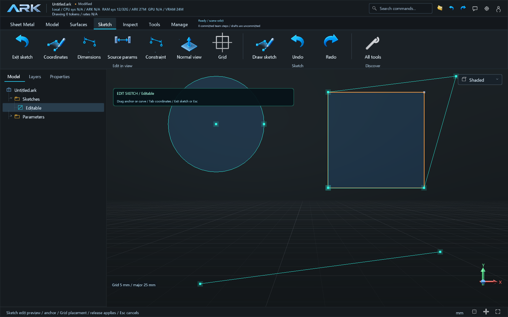
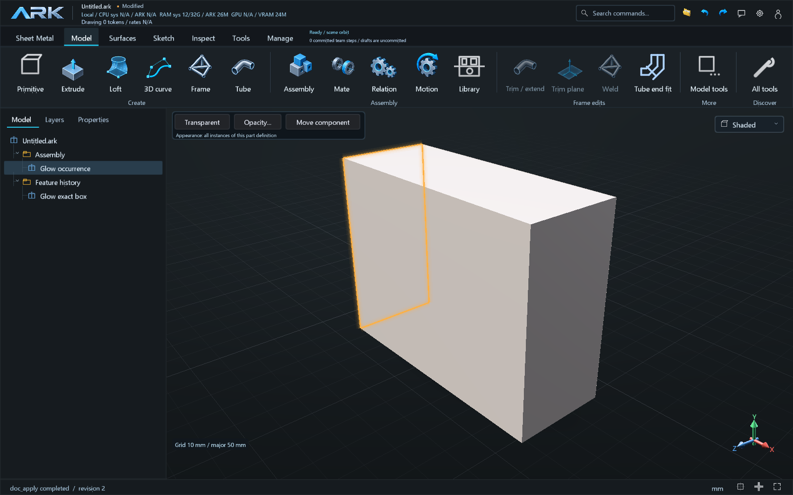
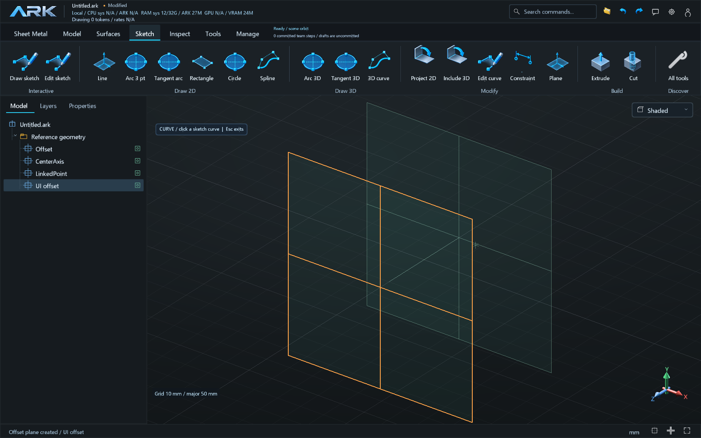
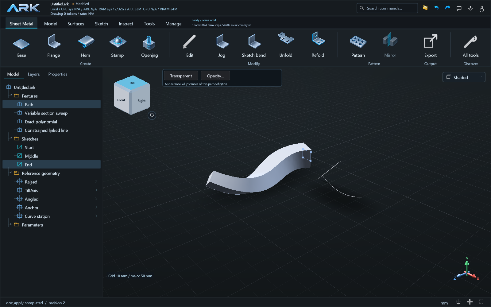

# 018B — editable sketches and associative construction geometry

Runtime `0.9.19`; principal phase B. This iteration extends the draft 017B work
on B.01/B.02/B.03 and the agent feedback/contract scopes D.02/D.04/E.01. These
milestones remain partial. Human acceptance is pending; PR #4 remains draft.

Saved sketches now support viewport endpoint, radius and whole-entity edits with
snapping, previews, expression retention and atomic publication. Typed entity
recipes expose editable source forms. Exact selected faces receive a boundary
halo scoped to the selected occurrence. Construction datums can be selected,
shown/hidden independently and authored from offset, angle, axes and point recipes.
Anchors can follow named datums, sketch endpoints and exact feature references.
Inspection exposes world coordinates; dependency guards reject invalid sources.

The sketch catalog includes the requested rectangle, slot, circle, arc, ellipse,
conic and spline variants, plus equation curves, points, construction lines,
stroke text, route and belt outlines. Exact native interpolating 3D splines and
UV splines feed sweeps. Varying sections use arc-length stations and dynamic
tangent frames, with retained roll and X guides.

Annotation 1's previous absence of a 3D solver is addressed by a bounded spatial
equality solver with measured local rank, free degrees of freedom and conflicts.
Polynomial/circle/ellipse equations now have analytic native paths. Arbitrary XYZ
formulas retain adaptive sampling with observed native-fit error checks, and
explicitly do not claim a general error bound between checkpoints.

A read-only review of the selected local printer generation found irrelevant web
search responses, empty marketplace pages, local/world datum confusion and
concurrent revision conflicts. Follow-ups add lexical candidate filtering,
empty-page rejection, clearer world-frame inspection/onboarding and cooperative
team write reservations. These observations are private local evidence, not a
public design benchmark or proof of cost savings. The original `drone_final`
file remains unavailable; its construction is not claimed as re-reviewed.

New source semantics use document format 34; legacy documents retain their
existing format unless they need a newer construct. Tests exercise source
roundtrip and rejection by unsupported versions.

Contracts and manual steps:

- [Manual acceptance](../AUTHORING_018B_TESTING.md)
- [Spatial constraints](../SPATIAL_SKETCH_CONSTRAINTS.md)
- [Construction datums](../CONSTRUCTION_DATUM_AUTHORING.md)
- [Sketch entities and varying sweep](../SKETCH_ENTITY_AUTHORING.md)

Verification: all 71 native groups passed (70 in the full run, OTA launch on an
isolated retry), 48 core groups and 12 actual UI workflows passed. The immutable
018B preview also executed the synthetic example successfully. [The receipt](../verification-018B.json)
retains the failed attempts, runtime hashes and inspected screenshots.
No user drawing is included in the source, screenshots or preview fixture.

